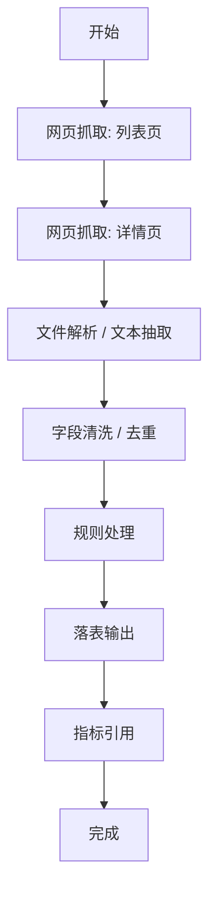

# 采集配置中心 · 流程画布功能设计方案

> **文档状态（2026-06-17）**：本文件是流程画布功能素材，不再作为唯一权威口径。当前权威方案见 `docs/采集配置中心_权威方案.md`。

> **历史过渡说明（2026-06-17）**：采集配置中心是**独立系统 = 数据采集平台（青龙）的重构前端**，不属于 WW / 万微投研。下文凡“万微投研 / WW”措辞，一律按“数据采集平台自身的新前端”理解。
> 日期：2026-06-17
> 当前验收入口：`prototypes/collect-config-center.html`（可直接打开的独立静态原型）
> 关联总方案：`docs/数据采集平台_前端重构总体方案.md`
> 方案目标：先统一流程画布的功能边界、交互能力和静态页面验收口径，再继续完善前端页面；网页抓取真实跑通放在静态页面确认之后。

---

## 1. 核心结论

采集配置中心的流程画布不应删减研究工作台已经验证过的画布能力。正确做法是：

1. **画布交互心智沿用研究工作台**：节点库、插入点、加入节点、加入决策、分头处理、右键菜单、节点状态、右侧详情都保留。
2. **业务配置语义换成采集中心**：采集类节点不再显示研究任务配置，而是承接数据中心“源配置 -> 表配置 -> 登录配置 -> 完成”四步。
3. **暂未跑通的执行能力不删除**：OCR、AI 提取、Python 抓取、发邮件、决策、分头处理等先以“规划中 / 待执行器 / 待权限确认 / 静态保留”表达。
4. **第一阶段只验收静态画布完整度**：页面内容、结构、交互状态先对齐；第二阶段再从“网页抓取”节点的试跑按钮进入真实调用。

一句话：**研究工作台负责提供画布能力基线，数据中心负责提供采集配置模型，采集配置中心负责把二者适配成可配置、可追溯、可扩展的采集流程画布。**

---

## 2. 范围与非范围

### 2.1 第一阶段范围

第一阶段只做前端静态页面完善，范围如下：

| 模块 | 必须完成 |
|---|---|
| 路由入口 | 使用 `prototypes/collect-config-center.html` 作为当前静态验收入口 |
| 页面定位 | 标题、导航、按钮、Tab、页面文案统一为“采集配置中心” |
| 二级 Tab | 保留 7 个页签：流程画布、采集资产、规则资产、指标中心、数据查看、运行记录、监控工具 |
| 画布能力 | 保留研究工作台式节点库、插入点、拖拽、加入节点、加入决策、分头处理、右键菜单 |
| 右侧详情 | 采集类节点展示四步；非采集类节点展示基础、输入映射、参数、产物、试跑 |
| 状态表达 | 已验证、建议补充、规划中、待执行器、待权限确认、待后端接入 |
| 静态表格 | 采集资产、规则资产、指标中心、数据查看、运行记录、监控工具补齐筛选、表格、状态、操作入口、空/异常状态 |

### 2.2 第一阶段不做

1. 不接真实网页抓取 API。
2. 不做真实保存、发布、重跑、落表。
3. 不新增正式产品路由替换当前入口。
4. 不把研究工作台页面作为采集配置中心的实现文件继续改。
5. 不因为采集场景暂时没有后端执行器就删掉画布能力。

### 2.3 第二阶段范围

第二阶段从“网页抓取”节点试跑开始接入真实调用：

| 能力 | 说明 |
|---|---|
| URL probe | 采集配置中心服务层校验 URL 可访问性、类型、标题、响应状态 |
| 抓取发起 | 从网页抓取节点试跑按钮触发 |
| 抓取状态 | 返回 L/C/E、进度、错误原因 |
| 抓取摘要 | 返回标题、正文摘要、链接、附件、样本字段 |
| 运行标识 | 生成并展示 `run_id` |
| 结果回写 | 回写右侧试跑区和运行记录页 |

---

## 3. 研究工作台能力保留清单

以下能力是流程画布基线，不应在采集配置中心中删除。

| 研究工作台能力 | 采集配置中心处理                        | 首期要求          |
| ------- | ------------------------------- | ------------- |
| 左侧节点库   | 保留，节点模板改为采集/解析/清洗/规则/输出/通知/逻辑控制 | P0            |
| 节点库收起展开 | 保留，左侧可折叠，不挤占画布                  | P0            |
| 拖拽插入节点  | 保留，拖到画布后按最近插入点落位；默认名称与节点模板名称一致 | P0            |
| 主链路插入点  | 保留，小号 `+` 打开“新建节点”弹窗             | P0            |
| 加入节点    | 保留，通过中间 `+` 弹窗、右键菜单等入口创建普通执行节点  | P0            |
| 加入决策    | 保留，作为采集链路条件分支的静态逻辑节点            | P0 静态         |
| 分头处理    | 保留，作为流程级并行的静态逻辑节点               | P0 静态         |
| 右键菜单    | 保留，支持配置、插入、复制、重排、启停、删除          | P0            |
| 点击节点看详情 | 保留，右侧详情随节点切换                    | P0            |
| 点击连线看详情 | 保留，用于子步骤/边配置                    | P0            |
| 节点状态    | 保留，显示待配置、可试跑、运行中、完成、失败、规划中      | P0            |
| 规划中节点   | 保留但灰显或标注，不允许误导为已跑通              | P0            |
| 试跑入口    | 保留按钮状态，真实调用第二阶段接入               | P0 静态 / P1 接口 |

调整总方案时，需要把“右键节点的配置、重排、复制、启停、删除可作为 P1 后续补充”改成：**右键菜单是首期静态页面必须可见的画布基础能力，真实持久化和后端执行可放到第二阶段。**

---

## 4. 采集配置中心画布结构

### 4.1 三栏布局

```
┌────────────┬──────────────────────────────┬────────────────────┐
│ 左：节点库  │ 中：流程画布                  │ 右：节点 / 连线详情  │
│ 可收起展开  │ 主链路、插入点、分支、状态      │ 表单、映射、产物、试跑 │
└────────────┴──────────────────────────────┴────────────────────┘
```

### 4.2 顶部画布工具条

流程画布顶部保留业务动作：

| 动作    | 目的                     | 首期行为                  |
| ----- | ---------------------- | --------------------- |
| 从模板新建 | 创建标准链路                 | 静态展示入口                |
| 版本    | 草稿/版本切换                | 静态展示入口                |
| 运行记录  | 跳转运行记录页                | 静态切换或入口               |

顶部工具条不放“加入节点 / 加入决策 / 分头处理”。这三类新增动作统一收敛到画布中间 `+` 弹窗和右键菜单，避免顶部按钮和画布插入点形成两套入口。

### 4.3 中部画布

画布默认以竖向主链路展示，阶段泳道暂不强制。推荐默认链路：



允许旁路节点：

| 旁路 | 用途 |
|---|---|
| 质量校验 | 校验失败回流或进入人工复核 |
| 异常告警 | 采集失败、规则阻断、校验失败时通知 |
| 提取数据发邮件 | 高风险或固定日报场景 |
| 决策分支 | 按条件走不同路径 |
| 分头处理 | 多路径并行再汇合 |

### 4.4 中间 `+` 新建节点弹窗

主链路上的小号 `+` 是新增节点的主入口。点击后弹出“新建节点”弹窗，而不是直接插入默认节点。

弹窗首屏展示三类：

| 类型 | 页面文案 | 说明 |
|---|---|---|
| 普通执行节点 | 加入节点 | 一个需要执行或配置的采集步骤，例如网页抓取、文件下载、数据清洗、规则处理 |
| 条件分支 | 加入决策 | 按条件选择其中一条路径 |
| 流程级并行 | 分头处理 | 多条路径同时处理，最终汇合 |

弹窗下方展示节点模板：

| 区域 | 模板示例 |
|---|---|
| 标准节点 | 网页抓取、文件下载、文件解析、字段清洗、规则处理、落表输出、指标引用 |
| 可选扩展 | OCR 识别、AI 提取、Python 抓取、提取数据发邮件、异常告警、人工复核 |
| 自定义 | 自定义节点，可在右侧详情调整节点名称、类型、输入映射和参数 |

弹窗行为：

1. 默认选中“加入节点”。
2. 选择模板后点击确认，在当前 `+` 所在位置插入节点。
3. 插入普通节点时，节点默认名称与所选模板名称保持一致，不自动追加“新增”等后缀。
4. 插入“加入决策”时，默认生成“决策分支”节点。
5. 插入“分头处理”时，默认生成“分头处理”节点。
6. 插入后自动选中新节点，右侧详情定位到“基础”配置。

### 4.5 新建流程 / 初始化画布

> 状态（2026-06-22 补充）：当前工程版顶部工具条只有「切换流程 / 运行记录」，缺 §4.2 已列出的「从模板新建」入口；且画布启动时强制载入种子 Demo（`公告规则采集链路_v3`），用户无法从零开一张干净画布。本节补齐该能力口径。

**初始化画布定义**：新建后得到一张最小可用流程 —— 只有 `开始 → 完成` 两个终端、中间为空、保留一个插入点 `+`，供用户自行编排；不再以满配 Demo 作为唯一起点。

**实现路线（2026-06-22 已定）：对话式预置模板智能匹配。** 顶部「＋ 新建流程」不直接插入默认节点，而是打开「描述你的采集需求」对话框，由智能体根据自然语言意图**推荐一条预置链路**。首期智能体走 mock 关键词 / 意图匹配，二期把同一端点指向真 LLM BFF，界面零改动 —— 与本项目「mock 现在、适配器换真后端在后」哲学一致。

#### 4.5.1 对话式挑选器

入口：顶部工具条「＋ 新建流程」→ 弹「描述你的采集需求」对话框。

| 区域 | 内容 |
|---|---|
| 输入框 | 自然语言需求，如「我想做个公共网页数据抓取」 |
| 快捷意图 chips | 公共网页抓取 / 登录站点抓取 / 文件下载解析 / 公告规则采集 / API 接入 |
| 推荐结果 | 智能体返回的链路摘要 + 推荐理由 + 至多 2 条备选 |
| 操作 | 采用 / 换一个 / 从空白开始 |

#### 4.5.2 推荐端点契约（规划）

新增端点 `flow/recommend`（规划，首期 mock，二期换真 LLM）：

```
recommendFlow({ prompt: string, intent?: string })
  → { flow: FlowDef, rationale: string, alternatives: { intent: string; name: string }[] }
```

- **mock 实现**：按 `prompt` / `intent` 关键词匹配预置意图，命中即返回对应预置 `FlowDef` + 理由；未命中回落到「标准链路模板」或空白并说明。
- **二期**：`recommendFlow` 指向真 LLM BFF，由模型把自然语言生成 / 挑选 `FlowDef`，返回结构经发布门禁同款校验后渲染。

#### 4.5.3 预置意图 → 链路（首期种子，可扩展）

| 意图 | 预置链路 |
|---|---|
| 公共网页抓取 | 开始 → 网页抓取(列表) → 网页抓取(详情) → 字段清洗 → 落表 → 完成 |
| 登录站点抓取 | 开始 → 网页抓取(列表，需登录) → 网页抓取(详情) → 字段清洗 → 落表 → 完成 |
| 文件下载解析 | 开始 → 文件下载 → 文件解析 → 字段抽取 → 落表 → 完成 |
| 公告规则采集 | §4.3 推荐默认链路（即现种子 Demo，抽为模板常量复用） |
| 空白 / 未命中 | `main = [开始, 完成]`、无旁路、无节点配置、新 `flowId`、名称「未命名流程」 |

#### 4.5.4 交互流程

1. 点「＋ 新建流程」→ 弹对话框。
2. 输入需求或点意图 chip → 调 `recommendFlow`。
3. 对话框展示推荐链路摘要 + 理由 + 备选。
4. **采用** → `flow.load(推荐)`，画布初始化，采集节点带占位（URL 待填等），自动选中第一个待配置节点。
5. **换一个** → 切到备选；**从空白开始** → 载入空白流程。
6. （二期）支持多轮追加：「再加一步规则处理」→ 智能体增量调整链路。

#### 4.5.5 行为要点

1. 新建生成独立 `flowId`，与已保存流程互不污染。
2. 采用 / 空白后自动选中第一个可编辑对象（空白则聚焦插入点 / 顶部「流程名称」）。
3. 存在未保存改动时，新建 / 切换前提示「当前流程未保存」。
4. 流程名称在顶部工具条可改，对齐 §5.4 节点名称的可编辑心智。
5. 推荐链路同样受发布门禁约束：占位未填的采集节点不可发布。

**默认启动行为**：系统首次进入（无已保存流程）默认载入**空白流程**；是否自动弹出对话框见 §12 待确认。

**与「切换流程」的关系**：切换流程 = 在已保存流程间切换；新建流程 = 经对话式挑选器产生一条新流程。二者并列于顶部工具条。

---

## 5. 节点体系

### 5.1 节点分类

| 分类 | 节点 | 首期状态 |
|---|---|---|
| 采集类 | 网页抓取、文件下载、Python 抓取 | 网页抓取 P0；文件下载静态；Python 待权限确认 |
| 解析类 | 文件解析、OCR 识别、AI 提取 | 文件解析静态；OCR/AI 待执行器 |
| 结构化类 | 字段抽取、结构化映射 | 静态保留 |
| 清洗类 | 字段清洗、去重、格式转换 | 静态保留 |
| 校验类 | 完整性校验、阈值校验、异常流转 | 静态保留 |
| 规则类 | 规则处理、规则包引用、规则 Trace | 静态保留，规则资产页治理 |
| 输出类 | 落表输出、指标引用 | 静态保留 |
| 通知类 | 提取数据发邮件、异常告警 | 静态保留，标注待执行器 |
| 逻辑控制 | 加入决策、分头处理、合并、人工复核 | 决策/分头首期静态保留 |

### 5.2 节点卡字段

| 区域 | 字段 |
|---|---|
| 标识 | 编号、节点名称、节点类型、底层映射 |
| 状态 | 待配置、可试跑、运行中、完成、失败、停用、规划中 |
| 摘要 | URL、配置 ID、输出表、参数数量、子步骤数量 |
| 产物 | 样本字段、原始文件、落表记录、规则 Trace、指标引用 |
| 风险 | 缺表、缺登录、执行器未确认、权限待确认、外部变更 |

### 5.3 规划中节点表达

不能适配或暂未确认执行器的节点不删除，统一按以下规则显示：

| 情况 | 页面表达 | 操作 |
|---|---|---|
| 执行器未确认 | “规划中 / 待执行器” | 可配置草稿，试跑置灰 |
| 权限未确认 | “待权限确认” | 可查看配置，执行置灰 |
| 后端接口未接 | “待接入” | 显示静态入口和说明状态 |
| 能力不适合首期 | “P2 / 建议补充” | 保留节点，不进入默认链路 |

---

### 5.4 节点名称

节点名称是可编辑字段，不应只由模板锁死。

| 场景 | 命名规则 |
|---|---|
| 拖拽插入节点 | 默认名称与节点模板名称一致 |
| 中间 `+` 弹窗插入 | 默认名称与所选模板名称一致 |
| 复制节点 | 可在默认名称后追加“复制”，但右侧可立即修改 |
| 右侧详情 | 基础配置中提供“节点名称”输入框 |
| 保存校验 | 同一流程内允许重名但提示风险；后续可按需要强制唯一 |

---

## 6. 加入节点、加入决策、分头处理

### 6.1 加入节点

“加入节点”用于创建普通执行节点，入口来自中间 `+` 弹窗或右键菜单，不放在顶部画布工具条。

首期行为：

1. 点击中间 `+` 后打开“新建节点”弹窗。
2. 默认选中“加入节点”类型。
3. 选择节点模板后确认插入。
4. 如果没有选中模板，默认插入“网页抓取”节点。
5. 节点默认名称与节点模板名称一致。
6. 右侧详情支持调整节点名称。
7. 插入后自动选中新节点。
8. 右侧详情自动切到该节点的配置页。
9. 下方节点自动下移，连线重绘。

### 6.2 加入决策

“加入决策”用于条件分支，不等同于普通节点。

首期静态行为：

1. 插入一个“决策分支”节点。
2. 右侧显示基础、输入映射、参数、产物、试跑 Tab。
3. 参数页展示条件表达式，例如 `status = C AND quality_score >= 0.95`。
4. 产物页展示 true_path、false_path、decision_trace。
5. 节点状态标注“静态保留 / 待执行器”。

后续真实行为：

1. 支持 2 条或多条条件路径。
2. 每条路径可继续加入节点、决策、分头处理。
3. 运行记录保留命中条件和未命中条件。

### 6.3 分头处理

“分头处理”是流程级并行，不是节点内部子任务。

首期静态行为：

1. 插入一个“分头处理”节点。
2. 右侧显示路径 A、路径 B、汇合点、并发上限、join_policy。
3. 节点状态标注“静态保留 / 待编排”。
4. 页面文案区分“流程级并行”和“节点内子任务”。

后续真实行为：

1. 支持 fan-out/fan-in。
2. 支持全部成功、任一失败告警、部分成功继续等汇合策略。
3. 运行记录按路径展示 branch_results 和 join_status。

---

## 7. 右键菜单设计

右键菜单是流程画布基础能力，首期静态页面必须保留。

### 7.1 节点右键

| 菜单项 | 首期静态行为 | 后续真实行为 |
|---|---|---|
| 配置节点 | 选中节点，右侧显示详情 | 打开可编辑配置并保存 |
| 加入节点 | 在当前节点后打开新建节点弹窗或插入普通节点 | 保存到流程结构 |
| 加入决策 | 在当前节点后插入决策节点 | 保存条件分支 |
| 分头处理 | 在当前节点后插入并行节点 | 保存并行结构 |
| 复制节点 | 复制当前节点配置并插入 | 复制引用关系需二次确认 |
| 上移 | 与上一个主链路节点交换位置 | 保存排序 |
| 下移 | 与下一个主链路节点交换位置 | 保存排序 |
| 启用 / 停用 | 切换页面状态 | 写入节点启停状态 |
| 删除节点 | 从画布移除 | 删除前检查引用和运行记录 |

### 7.2 画布空白处右键

| 菜单项 | 首期行为 |
|---|---|
| 加入节点 | 在最近插入点打开新建节点弹窗或插入普通节点 |
| 加入决策 | 在最近插入点插入决策节点 |
| 分头处理 | 在最近插入点插入并行节点 |

### 7.3 连线右键或点击

连线代表边配置，尤其是数据中心子步骤配置。

| 能力 | 首期行为 |
|---|---|
| 点击连线 | 右侧展示“步骤编排”详情 |
| 配置子步骤 | 展示适用源、输入表、使用配置、输出表、URL 来源字段、URL 规则、执行条件 |
| 启用 / 停用 | 静态展示状态 |
| 删除连线 | 首期可仅保留菜单入口，不实际删除 |

---

## 8. 右侧详情设计

### 8.1 采集类节点四步

网页抓取、文件下载、Python 抓取等采集类节点右侧使用数据中心四步：

| 步骤 | 主要字段 |
|---|---|
| 源配置 | 抓取类型、源 URL、源名称、源分类、代理、断点续爬、定时策略、标签 |
| 表配置 | 输出表、表 ID、物理表、字段、去重字段、输入参数、实体属性 |
| 登录配置 | 是否登录、登录 URL、账号、密码/凭证引用、Cookie/Token、代理策略 |
| 完成 | 配置摘要、源/配置/表/定时汇总、提交、保存草稿、上一步 |

要求：

1. 字段命名尽量沿用数据中心。
2. 采集配置中心只补充流程、节点、引用、审计，不改数据中心字段含义。
3. 接口未开放时，保存为采集配置中心草稿；真实落库后再回写 `source_id/config_id/table_id`。

### 8.2 非采集类节点 Tab

| Tab | 内容 |
|---|---|
| 基础 | 节点名、能力状态、负责人、执行器、失败策略 |
| 输入映射 | 上游字段到本节点入参的映射 |
| 参数 | 函数、阈值、schema、规则包、并发策略 |
| 产物 | 输出字段、Trace、文件、落表记录、指标引用 |
| 试跑 | 样本输入、执行器状态、最近结果、日志入口 |

### 8.3 连线详情

连线详情用于表达子步骤/边配置：

| 字段 | 说明 |
|---|---|
| 适用源 | 当前配置适用范围 |
| 步骤输入表 | 上一步输出表 |
| 步骤名称 | 子步骤名称 |
| 本步骤使用配置 | 子步骤配置 ID |
| 步骤输出表 | 子步骤落表 |
| URL 来源字段 | 从上一步哪个字段取 URL |
| URL 规则 | `$VAL$` 或动态函数 |
| 执行条件 | 条件表达式 |
| 失败动作 | 跳过、重试、阻断、告警 |

---

## 9. P0 画布细化设计

本节用于指导下一轮静态页面开发。目标不是接后端，而是把画布表达做完整，让用户看得出“普通节点、决策、分头处理”三类结构的差异。

### 9.1 新建节点弹窗

弹窗按截图方向设计，首屏不出现复杂配置，只做类型选择和模板选择。

| 区域 | 设计要求 |
|---|---|
| 标题 | `新建节点` |
| 类型卡 | 三张卡：`加入节点`、`加入决策`、`分头处理` |
| 默认选中 | `加入节点` |
| 模板区 | 只在 `加入节点` 选中时展示模板；选中 `加入决策 / 分头处理` 时模板区弱化或隐藏 |
| 标准节点 | 网页抓取、文件下载、文件解析、字段清洗、去重处理、质量校验、规则处理、落表输出、指标引用 |
| 可选扩展 | OCR 识别、AI 提取、Python 抓取、提取数据发邮件、异常告警、人工复核 |
| 自定义 | `自定义节点`，确认后插入一个可改名的普通节点 |
| 底部按钮 | `取消`、`确认` |

确认按钮状态：

| 当前选择 | 确认按钮 |
|---|---|
| 加入节点 + 已选模板 | 可点击 |
| 加入节点 + 未选模板 | 禁用或默认选中“网页抓取” |
| 加入决策 | 可点击 |
| 分头处理 | 可点击 |

插入结果：

| 类型 | 插入节点默认名称 | 右侧详情默认 Tab |
|---|---|---|
| 加入节点 | 等于模板名称，例如 `文件解析` | 基础或源配置 |
| 加入决策 | `决策分支` | 基础 |
| 分头处理 | `分头处理` | 基础 |
| 自定义节点 | `自定义节点` | 基础，聚焦节点名称 |

### 9.2 普通节点画布表达

普通节点仍使用当前卡片样式，但需要把节点名称、状态、类型和产物信息固定下来。

| 元素 | 展示 |
|---|---|
| 图标 | 底层能力编码或短标签，例如 `90`、`PARSE`、`R` |
| 标题 | 节点名称，可由右侧详情修改 |
| 类型 | 网页抓取、文件解析、规则处理等 |
| 左下角 chip | 配置状态，例如待配置、草稿、可试跑、规划中 |
| 右下角摘要 | 源配置、待试跑、输出表、字段数等 |

拖拽插入时，默认名称必须等于模板名称，不自动追加“新增”。复制节点可以追加“复制”，但插入后右侧必须允许立即改名。

### 9.3 决策分支画布表达

决策节点不能只像普通节点。首期静态画布至少要表达“条件判断”和“两条路径”。

建议视觉：

```text
        [决策分支]
     条件：status = C
      /              \
  通过路径        失败/复核路径
```

首期简化实现可以采用以下结构：

| 元素 | 展示 |
|---|---|
| 决策头节点 | 琥珀色边框或浅黄背景，图标 `IF` |
| 条件摘要 | `抓取成功且字段完整` |
| 路径摘要 | `通过路径`、`失败/复核路径` 两个小标签 |
| 汇合提示 | 如果暂不渲染真实分支线，底部显示 `静态保留 · 待执行器` |

右侧详情：

| Tab | 字段 |
|---|---|
| 基础 | 节点名称、分支名称、能力状态、默认路径 |
| 输入映射 | `status`、`quality_score` 等上游字段 |
| 参数 | 条件 1、条件 2、默认条件 |
| 产物 | true_path、false_path、decision_trace |
| 试跑 | 暂显示静态样例，真实执行二期 |

### 9.4 分头处理画布表达

分头处理是流程级并行，不是节点内子任务。首期静态画布必须让用户看出“多路径同时处理后汇合”。

建议视觉：

```text
        [分头处理]
       /     |      \
   路径 A  路径 B  路径 C
       \     |      /
          [汇合]
```

首期简化实现可以采用以下结构：

| 元素 | 展示 |
|---|---|
| 并行头节点 | 灰蓝边框或浅灰背景，图标 `PAR` |
| 路径摘要 | `路径 A 结构化清洗`、`路径 B 规则命中` |
| 汇合摘要 | `汇合点：质量校验` |
| 状态 | `静态保留 · 待编排` |

右侧详情：

| Tab | 字段 |
|---|---|
| 基础 | 节点名称、并行名称、汇合点、并发上限 |
| 输入映射 | rows、run_id |
| 参数 | branches、join_policy |
| 产物 | branch_results、join_status、parallel_trace |
| 试跑 | 暂显示静态样例，真实 fan-out/fan-in 二期 |

### 9.5 右键菜单细化

右键菜单首期保留，但不同对象菜单不同。

节点右键：

| 菜单项 | 行为 |
|---|---|
| 配置节点 | 选中节点，打开右侧详情 |
| 加入节点 | 打开新建节点弹窗，默认类型为加入节点 |
| 加入决策 | 打开新建节点弹窗，默认类型为加入决策 |
| 分头处理 | 打开新建节点弹窗，默认类型为分头处理 |
| 复制节点 | 复制当前节点，节点名可加“复制” |
| 上移 / 下移 | 调整主链路顺序 |
| 启用 / 停用 | 同步节点视觉状态和右侧状态文案 |
| 删除节点 | 首期可直接删除；P1 增加确认 |

画布空白处右键：

| 菜单项 | 行为 |
|---|---|
| 加入节点 | 在最近插入点打开新建节点弹窗 |
| 加入决策 | 在最近插入点打开新建节点弹窗并选中加入决策 |
| 分头处理 | 在最近插入点打开新建节点弹窗并选中分头处理 |

连线点击或右键：

| 菜单项 | 行为 |
|---|---|
| 配置子步骤 | 右侧展示步骤编排 |
| 启用 / 停用 | 静态状态切换 |
| 删除连线 | P1 再做，首期保留入口或不展示 |

### 9.6 节点名称与源名称边界

节点名称和数据中心源名称不能混用。

| 名称 | 所属对象 | 用途 |
|---|---|---|
| 节点名称 | 采集配置中心流程画布节点 | 画布卡片、运行记录、右侧详情标题 |
| 源名称 | 数据中心 source | 数据中心源列表、源配置、任务发起 |
| 配置名称 | 数据中心 config | 采集配置、子步骤配置 |
| 表名称 | 数据中心 entry_type / table | 落表和数据查看 |

采集类节点右侧建议同时展示：

1. `节点名称`：在右侧最上方，修改后同步画布卡片。
2. `源名称`：保留在源配置表单内，代表数据中心源名称。

### 9.7 P0 页面开发拆解

| 顺序 | 任务 | 验收 |
|---|---|---|
| 1 | 弹窗视觉细化 | 弹窗与截图结构一致，三类卡片清晰 |
| 2 | 决策节点画布表达 | 插入后能看出条件分支，不像普通节点 |
| 3 | 分头处理画布表达 | 插入后能看出并行路径和汇合 |
| 4 | 右键菜单统一弹窗入口 | 菜单文案和行为与中间 `+` 一致 |
| 5 | 节点名称/源名称区分 | 右侧两个字段语义清楚，不互相覆盖 |
| 6 | 启停状态同步 | 停用后节点视觉和右侧状态都变化 |
| 7 | 多次插入稳定性 | 连续插入 3 个节点后，布局和连线不重叠 |

---

## 10. 静态页面验收标准

第一阶段验收只看静态页面和交互状态。

| 验收项 | 标准 |
|---|---|
| 入口 | 打开 `prototypes/collect-config-center.html` 查看采集配置中心静态原型 |
| 标题 | 页面主定位没有“规则配置中心”残留 |
| Tab | 7 个页签完整可切换 |
| 节点库 | 可收起展开，节点模板完整 |
| 拖拽 | 可拖拽模板到画布插入，默认名称与节点模板一致 |
| 插入点 | 主链路小号 `+` 打开“新建节点”弹窗 |
| 加入节点 | 弹窗或菜单可见，并能插入节点 |
| 加入决策 | 可见，并能插入决策节点；画布能看出条件分支语义 |
| 分头处理 | 可见，并能插入并行节点；画布能看出多路径汇合语义 |
| 节点名称 | 右侧基础配置可调整节点名称 |
| 右键菜单 | 节点右键出现配置、插入、复制、重排、启停、删除 |
| 连线配置 | 点击连线进入右侧步骤编排详情 |
| 右侧详情 | 采集类四步；非采集类五个 Tab |
| 规划中能力 | OCR、AI 提取、发邮件等不删除，只标注状态 |
| 空/异常状态 | 采集资产、规则资产、指标中心、数据查看、运行记录、监控工具均有静态空/异常状态 |

---

## 11. 后续实现顺序

建议按以下顺序推进：

1. **确认本设计方案**：重点确认中间 `+` 弹窗、加入节点、加入决策、分头处理、右键菜单是否作为 P0 静态能力。
2. **修订总方案**：把右键菜单从“P1 后续补充”改为“P0 静态保留”。
3. **统一前端页面**：已整理为 `prototypes/collect-config-center.html` 独立静态 HTML。
4. **静态验收**：人工验证 7 个 Tab、节点库、拖拽、插入、右键、详情切换。
5. **网页抓取跑通**：从网页抓取节点试跑按钮接采集配置中心服务层。
6. **回归测试**：进入工程化后再补自动化测试；当前静态 HTML 阶段以脚本解析和浏览器打开验收为主。

---

## 12. 待确认问题

| 问题 | 建议 |
|---|---|
| 是否继续短期使用旧 `rule-center-prototype` 命名 | 否，静态原型已统一为 `collect-config-center` |
| 是否现在确定正式产品路由 | 暂不确定；当前只是静态原型标签，不代表最终产品路由 |
| 右键菜单是否首期必须有 | 是，属于研究工作台画布基线能力 |
| 决策/分头是否首期真实执行 | 否，首期静态保留，真实执行二期 |
| 网页抓取是否现在接后端 | 否，静态页面确认后再接 |
| 流程画布首次进入：直接空白画布 / 自动弹新建对话框 / 保留 Demo | **已定（2026-06-23）**：默认空白画布 + 空状态引导卡，不自动弹框；Demo 降为「公告规则采集」意图模板。M5.5 已实现（见 §4.5） |
