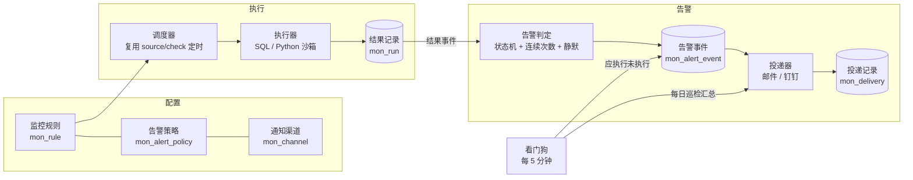
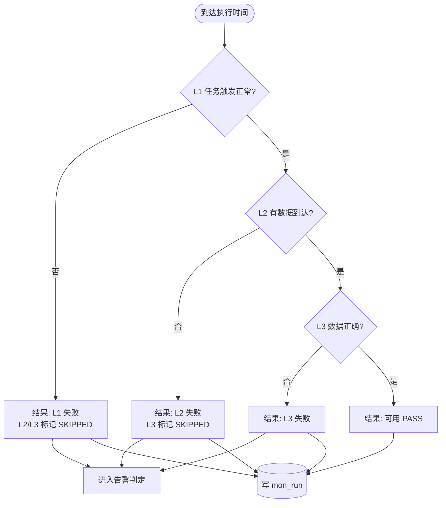
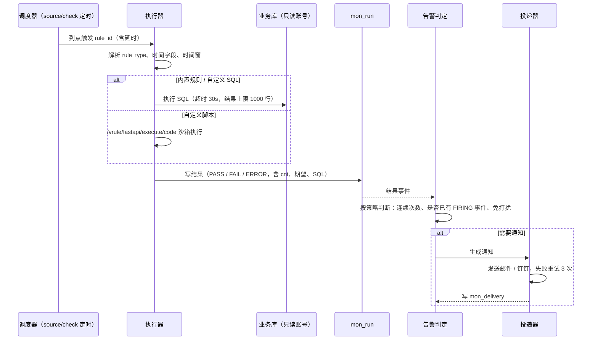
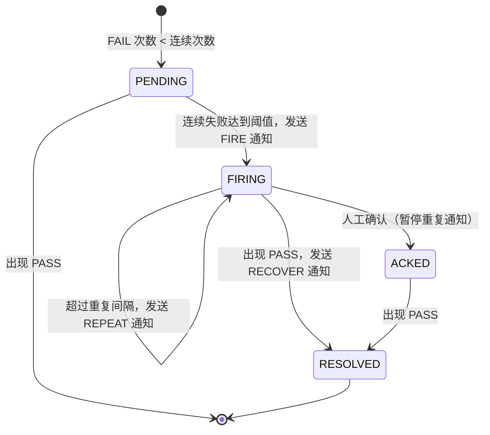
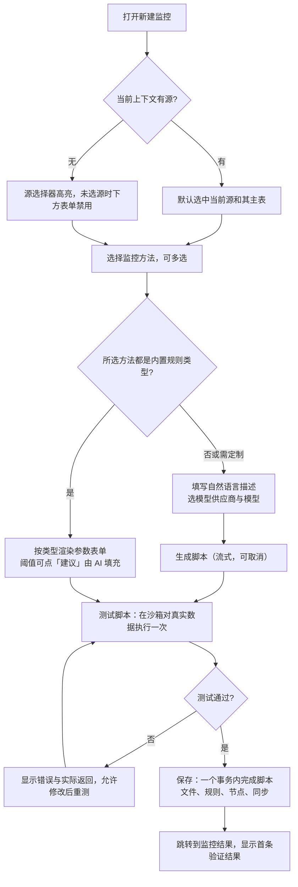

# 青龙智能采集中心 · 开发设计方案

## 监控中心重构与采集平台优化（2026-11 迭代）

| 项目 | 内容 |
| --- | --- |
| 文档版本 | v0.1（草案，待评审） |
| 编写日期 | 2026-11-06 |
| 输入材料 | 2026-11-05 内部会议转写（`已粘贴的文本.txt`）、《系统概览-青龙智能采集中心》、前端构建包 `front-ce-dist`（提交 3b648bc「动态菜单优化」） |
| 适用范围 | 监控中心（重点）、代码生成 / 任务中心、流程中心、数据中心 / 文件中心、规则资产、指标中心 |
| 说明 | 现状部分依据前端构建产物里的页面、字段和接口登记表整理，**没有看后端源码和数据库**。凡标注「待确认」的地方需要后端负责人核实。会议转写识别错误较多，个别需求是根据上下文推断的，已标注「推断」。 |

---

## 目录

1. [背景与目标](#1-背景与目标)
2. [需求清单](#2-需求清单)
3. [现有系统基线](#3-现有系统基线)
4. [监控中心详细设计（重点）](#4-监控中心详细设计重点)
5. [代码生成与任务中心](#5-代码生成与任务中心)
6. [流程中心：流程精简与两级归类](#6-流程中心流程精简与两级归类)
7. [数据中心与文件中心](#7-数据中心与文件中心)
8. [规则资产：简单规则与复杂规则](#8-规则资产简单规则与复杂规则)
9. [指标中心](#9-指标中心)
10. [运维与数据治理事项](#10-运维与数据治理事项)
11. [里程碑与分工](#11-里程碑与分工)
12. [验收标准](#12-验收标准)
13. [风险与待确认事项](#13-风险与待确认事项)

---

## 1. 背景与目标

### 1.1 背景

平台的「源 → 流程 → 处理机 → 入库」主链路已经基本跑通，近期暴露的问题集中在**数据质量的发现与追责**上：

- 客户反馈数据异常（贝壳房产数据每隔一两个月就出一次问题），但我们自己没有提前发现。
- 现场排查时，分不清是**采集任务没跑**、**跑了没数据**、**数据不对**，还是**监控 / 告警本身挂了**。客户那边没收到告警，就默认数据正常。
- 新的「数据监控节点」（AI 生成监控脚本）在演示中走不通：没有默认源、生成后保存不上、保存弹窗反复关闭。
- 监控阈值完全靠人工经验填写，几百个源靠人肉盯不过来，夜间（如凌晨 3 点）产出的数据更难盯。

### 1.2 目标

| 编号 | 目标 | 衡量方式 |
| --- | --- | --- |
| G1 | **监控不静默**：每个启用的监控每个周期都必须留下一条结果记录，监控没跑也要能被发现 | 「应执行未执行」能在 1 个周期内告警 |
| G2 | **问题可定位**：一次异常能明确归因到「调度 / 任务 / 数据到达 / 数据正确性 / 告警投递」中的某一层 | 结果记录包含分层状态和原始指标 |
| G3 | **配置可落地**：数据监控节点从「选源 → 选方法 → 生成脚本 → 测试 → 保存 → 定时运行」全流程可用 | 端到端演示通过 |
| G4 | **告警真实送达**：告警策略和通知渠道接入真实发送，并记录投递结果 | 投递记录可查，失败可重试 |
| G5 | **降低人工配置成本**（二期）：基于历史数据自动建议数量范围和时间窗 | 新建监控时给出建议阈值 |
| G6 | 代码生成、流程中心、数据中心等模块完成会议上提出的体验问题修复 | 见第 5–9 章验收项 |

### 1.3 不在本期范围

- 智能问数（`/ai-chat`）前端接入真实接口。
- 规则资产的批测、发布门禁二期。
- 采集程序本身的稳定性优化（由采集负责同事另行跟进；会议结论是「监控只帮你发现问题，根因还是采集程序」）。

---

## 2. 需求清单

会议中提出的问题整理成需求，后文各章按编号引用。

| 编号 | 模块 | 需求 | 优先级 | 来源 |
| --- | --- | --- | --- | --- |
| MON-01 | 监控 | 新建监控时默认带出当前源，无源时引导选择 | P0 | 演示时生成失败，原因是没选源 |
| MON-02 | 监控 | 修复「生成脚本后保存不上」「保存后弹窗关闭 / 反复弹出」 | P0 | 演示问题 |
| MON-03 | 监控 | 模型可选（DeepSeek、混元、MiniMax 等），默认模型不可用时给出明确提示并允许切换 | P0 | 演示时 DeepSeek 调用失败 |
| MON-04 | 监控 | 规则（检查数据是否正常）与告警（如何通知）拆成两个独立模块 | P0 | 会议明确结论 |
| MON-05 | 监控 | 日度数据每个周期必须有一条结果，无论 0 条还是 100 条；没有结果视为监控异常 | P0 | 会议明确结论 |
| MON-06 | 监控 | 监控执行结果与告警投递结果分开记录、分开展示 | P0 | 会议明确结论 |
| MON-07 | 监控 | 执行结果要回显实际指标（如 `cnt` 查出多少条、期望范围、执行的 SQL） | P0 | 数据专员反馈 |
| MON-08 | 监控 | 按生成时间 / 变更时间 / 保存时间分别使用正确的时间字段，不再统一用 `modified_date` | P1 | 数据专员发现 |
| MON-09 | 监控 | 新增「任务触发」层检查：任务应下发未下发、下发后规定时间内无入库 | P1 | 「上次任务后有保存」场景 |
| MON-10 | 监控 | 监控页面分「监控配置」「监控结果」，结果支持立即运行、查看日志 | P1 | 已有雏形，完善 |
| MON-11 | 监控 | 基于近 7–14 天数据自动建议数量范围和产出时间窗 | P2 | 会议提出的长期方向 |
| MON-12 | 监控 | 重点源巡检清单（采集负责同事提供的约 10 个源）优先配置监控 | P0 | 运营安排 |
| CG-01 | 代码生成 | 生成任务时可选择流程，默认「全部流程」，不再隐式使用某个流程 | P1 | 演示问题 |
| CG-02 | 代码生成 | 绑定源时支持按网站 / 业务目录 / 来源组批量关联 | P1 | 演示问题 |
| CG-03 | 任务中心 | 任务详情完整展示提示词、模型、实际请求、过程输出、生成结果；修正生成状态 | P1 | 演示问题 |
| CG-04 | 任务中心 | 页面样式与现有二级页面统一，左右分栏（左列表、右详情） | P2 | 会议结论 |
| FL-01 | 流程中心 | 流程两级归类：流程模板 → 同模板下按节点配置差异分组 | P1 | 约 770 个流程、4000+ 未归类 |
| FL-02 | 流程中心 | 未归类流程的整理方案，为后续 AI 选流程做准备 | P2 | 会议提出 |
| DC-01 | 数据中心 | 表不存在但有记录时不报错，接口返回「表缺失」状态，前端标识 | P1 | 演示报错 |
| DC-02 | 数据中心 | 每张表返回大致行数，点「更新」时实时计算 | P1 | 会议提出 |
| FC-01 | 文件中心 | 左侧加网站 / 目录列表，可按网站查看文件 | P1 | 会议提出 |
| RL-01 | 规则资产 | 规则区分简单规则（直接选用）与复杂规则（AI 生成脚本） | P2 | 会议提出 |
| MT-01 | 指标中心 | 保留现有 mock，先梳理指标模型，再给出优化方案 | P3 | 会议提出 |
| OPS-01 | 运维 | 清理错误同步到客户侧的数据并通知对方重新同步 | P0 | 会议开头（推断） |
| OPS-02 | 运维 | 服务目前只有 217 能访问，其他节点返回 404，需要补齐 | P0 | 会议提出 |

---

## 3. 现有系统基线

### 3.1 技术形态

| 层 | 现状 |
| --- | --- |
| 前端 | Vue 3 + Vite + Element Plus，Hash 路由，菜单与页内 Tab 由后端动态下发 |
| 主服务 | `:9999`，前端以 `/api/...` 访问；前端内置接口登记表，旧平台接口以 `/v1/...` 映射 |
| 规则 / AI 服务 | `/vrule/...`：`/vrule/ai/dashscope/stream`（生成脚本，流式）、`/vrule/fastapi/execute/dynamic`（测试脚本）、`/vrule/fastapi/execute/code`（执行脚本） |
| 文件服务 | `:9102`，脚本以文件形式保存（`file/upload`、`file/download`） |
| 代码生成 | 内网 Windows 代码生成服务器（WB-AGENT / hy3、Gemini Agent），任务落库后由服务器领取 |
| 执行 | 处理机 / Runner，通过 MQ 队列下发 |

### 3.2 监控中心现状

前端 `/monitor` 下有 6 个页签，背后是**三套互相独立的实现**：

| 页签 / 入口 | 实现 | 接口 | 状态 |
| --- | --- | --- | --- |
| 数据源告警 | 旧平台「源检查」，按 cron 执行 SQL 检查 | `source/check/*`（paged / add / update / delete / changeEnable / check-one / runNow / paged-logs）、`source/lastRun` | **真实可用**，生产在用 |
| 源问题 | 人工登记的源问题 | `source/issue/*` | 真实 |
| 队列告警 | MQ 队列积压检查 | `mq/check/*` | 真实 |
| 自定义告警 | 通用定时任务（comm-job） | `comm-job/*` | 真实 |
| 任务实例 / 任务统计 | 任务运行记录 | `task/topTaskPaged`、`task/stat` | 真实 |
| 流程画布里的「数据监控节点」 | 新设计：选监控方法 + 自然语言描述 → AI 生成脚本 | `rule/orchestrationGenerate` / `orchestrationTest` / `orchestrationSaveMeta`，保存后同步到 `monitor/ckSource*`（`/api/source/insert|update`） | **半成品**，演示走不通 |
| 节点内「告警配置」面板 | 告警策略（等级、指标、比较符、阈值、连续次数、重复间隔、恢复通知）+ 渠道（邮件、钉钉） | 无 | **纯演示**，页面自注「发送接口待接入」 |
| 源工作区「监控」 | `SiteMonitorView`：「监控结果」「监控配置」两个页签 | 复用 `source/check/*` | 真实，展示字段偏少 |

**旧「源检查」的配置项**（`CheckEditDialog`）是目前唯一真正在线上跑的监控规则，字段如下：

| 字段 | 含义 | 备注 |
| --- | --- | --- |
| `sourceId` / `tableName` / `name` | 数据源、目标表、监控名 | |
| `cron` / 延时 | 定时表达式；延时用于「采集任务后 N 分钟触发校验」 | 默认策略示例：定时采集任务后 30 分钟触发 |
| `timeType` | 时间类型：按生成时间（新增量）/ 按变更时间（变化量）/ 按保存时间（保存量，含去重）/ 上次任务后有保存 | **当前实现统一用 `modified_date`**（MON-08） |
| `minSize` / `maxSize` | 数量范围 | |
| `cond` | 时间表达式或自定义条件 SQL；SELECT 需返回 `cnt`、`maxId` 两个字段 | |
| `checkRule` | 自定义规则（动态表达式，env 中有 `cnt`、`maxId`） | |
| `checkMsg` | 告警提示模板 | |
| `notifyOn` | 校验失败时推送 / 成功时推送 / 均推送 / 均不发送（静默） | |
| `notifyType` / `mailTo` | 邮件、钉钉（系统级机器人）；更多收件人 | |
| 默认策略 | 当日无新增数据即告警 | |

**新「数据监控节点」的监控方法**（前端内置 24 项，可多选）：

> 当日数据是否正常入库、数据延迟监控、入库时间分布监控、最新数据时间监控、连续无数据天数监控、每日数据量监控、历史趋势稳定性监控、环比数据量波动监控、同比周期波动监控、分品类数据量趋势、核心字段为空监控、数据完整性监控、字段格式合法性监控、字符串值监控、单位规范性监控、价格异常监控、价格波动监控、涨跌幅阈值监控、品类覆盖率监控、今日与昨日差异监控、分系列数据量趋势、系列覆盖率监控、分品名数据量趋势、品名覆盖率监控

### 3.3 现状问题归纳

| 问题 | 根因分析 | 对应需求 |
| --- | --- | --- |
| 没告警就以为正常 | 「静默模式」和「仅失败推送」下，监控没执行和数据正常在结果上无法区分；没有「应执行未执行」检查 | MON-05 |
| 分不清哪一层出了问题 | 校验结果只有「告警 / 正常」一个状态，没有分层；告警是否送达没有记录 | MON-04、MON-06 |
| 结果看不出依据 | 日志不保存 `cnt`、期望范围、实际执行的 SQL | MON-07 |
| 时间口径错误 | 三种时间类型共用 `modified_date` | MON-08 |
| 新监控节点不可用 | 无默认源、模型调用失败无降级、保存链路（脚本文件上传 → 节点保存 → 同步监控源配置）任一步失败就整体中断 | MON-01/02/03 |
| 三套监控各自为政 | 新节点与旧源检查只通过 `ckSource` 同步，告警面板没有后端 | MON-04 |

---

## 4. 监控中心详细设计（重点）

### 4.1 设计原则

1. **规则与告警分离**。规则只回答「数据是否正常」，产出结果记录；告警只回答「结果异常时通知谁、怎么通知」，产出投递记录。两者通过结果事件解耦。
2. **每次执行必留痕**。监控每跑一次都写一条结果记录（含通过），绝不只在失败时写。
3. **分层判断，逐层短路**。先查调度，再查任务，再查数据到达，最后查数据质量；上一层失败时下一层标记为「跳过」，不重复报警。
4. **兜底监控监控者**。由平台级看门狗检查「应该执行但没有结果」的监控，并发出系统级告警。
5. **复用旧源检查，渐进迁移**。`source/check` 已在生产运行，新设计以它为执行内核扩展字段，不另起一套调度。
6. **AI 只生成，不直连生产库执行**。AI 生成的脚本必须经过测试、人工保存，并在只读账号、超时、行数上限的沙箱中运行。

### 4.2 总体架构



### 4.3 四层检查模型

每条监控规则属于一个**层级**，同一个源的规则按层级依次判断。

| 层级 | 名称 | 回答的问题 | 典型规则 | 数据来源 |
| --- | --- | --- | --- | --- |
| L0 | 监控健康 | 监控本身按时执行了吗？告警送出去了吗？ | 应执行未执行、执行异常、投递失败 | `mon_run`、`mon_delivery`（平台内置，无需配置） |
| L1 | 任务触发 | 采集任务按时生成和下发了吗？ | 定时任务未触发、任务失败、任务下发后 N 分钟无入库（即「上次任务后有保存」） | `job`、`task/topTaskPaged`、入库表 |
| L2 | 数据到达 | 有没有数据进来？ | 当日数据是否正常入库、数据延迟、最新数据时间、连续无数据天数、入库时间分布 | 入库表的时间字段 |
| L3 | 数据正确 | 进来的数据对不对？ | 每日数据量范围、环比 / 同比波动、核心字段为空、完整性、格式合法性、价格异常、覆盖率 | 入库表的内容 |
| L4 | 数据可用（结论） | 这份数据今天能不能交付使用？ | 由 L1–L3 汇总得出，不单独配置 | 汇总 |

**判断顺序与短路规则**



> 会议原话的落地：「先看任务有没有生成触发；任务正常了再看有没有数据；有数据了再看数据对不对；最后才是可用状态。」

### 4.4 规则类型定义

把旧 `timeType` 和新监控方法统一成**规则类型（`rule_type`）**。每种类型有固定的参数和判定逻辑，前端按类型渲染表单，AI 生成的脚本也必须符合对应类型的输出契约。

| rule_type | 层级 | 名称 | 关键参数 | 判定逻辑 | 对应旧配置 |
| --- | --- | --- | --- | --- | --- |
| `TASK_TRIGGERED` | L1 | 定时任务已触发 | 期望触发时间窗 | 时间窗内存在该源的任务实例 | 无（新增） |
| `SAVED_AFTER_TASK` | L1 | 任务后有入库 | 任务后等待分钟数 | 最近一次任务下发后 N 分钟内，保存时间字段有新记录 | 上次任务后有保存 |
| `NEW_COUNT` | L2 | 新增量 | 时间窗、时间字段（默认创建时间） | `cnt` 在 [min, max] 内 | 按生成时间 |
| `CHANGE_COUNT` | L2 | 变更量 | 时间窗、时间字段（默认修改时间） | 同上，针对 update 型数据 | 按变更时间 |
| `SAVE_COUNT` | L2 | 保存量（含去重） | 时间窗、时间字段（默认保存时间） | 同上 | 按保存时间 |
| `LATENCY` | L2 | 数据延迟 / 最新数据时间 | 允许延迟分钟数 | `now - max(time_field) <= 阈值` | 无 |
| `NO_DATA_DAYS` | L2 | 连续无数据天数 | 天数 | 连续无数据天数 < 阈值 | 无 |
| `TIME_DISTRIBUTION` | L2 | 入库时间分布 | 期望时段 | 当日入库主要落在期望时段 | 无 |
| `VOLUME_RANGE` | L3 | 每日数据量范围 | min、max（可由 AI 建议） | 例：每天应有 50 个城市，实际 20 条即异常 | 数量范围 |
| `VOLUME_WAVE` | L3 | 环比 / 同比波动 | 对比周期、允许波动比例 | `abs(今日-基准)/基准 <= 比例` | 无 |
| `NULL_RATE` | L3 | 核心字段空值率 | 字段列表、阈值 | 空值率 <= 阈值 | 无 |
| `FORMAT` | L3 | 字段格式合法性 | 字段、正则 / 类型 | 不合法行数 <= 阈值 | 无 |
| `VALUE_ANOMALY` | L3 | 价格 / 涨跌幅异常 | 字段、阈值 | 超阈值行数 <= 阈值 | 无 |
| `COVERAGE` | L3 | 品类 / 系列 / 品名覆盖率 | 维度字段、期望集合或数量 | 覆盖数 >= 期望 | 无 |
| `CUSTOM_SQL` | L2/L3 | 自定义 SQL | SQL（返回 `cnt`、`maxId`，可附加列）、判定表达式 | 表达式为真即通过 | 自定义条件 SQL + 自定义规则 |
| `CUSTOM_SCRIPT` | L2/L3 | 自定义脚本（AI 生成） | Python 脚本 | 脚本返回 `status` | 数据监控节点 |

前端 24 项「监控方法」到规则类型的映射在前端常量里维护（例如「分品类数据量趋势」「分系列数据量趋势」「分品名数据量趋势」都映射为 `VOLUME_WAVE` + 分组维度字段）。

#### 4.4.1 时间字段修正（MON-08）

问题：所有规则的时间条件都用 `modified_date`。首次入库时 `create_date` 与 `modified_date` 相同，所以新增量看起来没问题；一旦数据被 update，按「新增量」统计就会把更新记录也算进去。

方案：

1. 在**表级**维护时间字段映射（`mon_table_time_field`）：创建时间字段、修改时间字段、保存时间字段。默认值由后端根据表结构自动识别（字段名匹配 `create*` / `modif*|update*` / `save*|insert*`），可人工修改。
2. 规则按 `rule_type` 取对应字段：`NEW_COUNT` 用创建时间，`CHANGE_COUNT` 用修改时间，`SAVE_COUNT` 和 `SAVED_AFTER_TASK` 用保存时间。
3. 表里找不到某类字段时，该规则类型在表单中置灰并提示原因，不再静默回退到 `modified_date`。
4. 存量规则迁移时**保持原行为**（迁移脚本把存量 `NEW_COUNT` 规则的时间字段显式设为 `modified_date`），由数据专员逐个核对后再切换，避免切换后大面积误报。

#### 4.4.2 时间窗表达式

沿用旧平台「时间表达（MySQL）」写法，统一成三个预设加一个自定义：

| 预设 | 含义 | 生成的条件（示意） |
| --- | --- | --- |
| `TODAY` | 自然日当天 | `{time_field} >= CURRENT_DATE` |
| `LAST_N_HOURS` | 最近 N 小时 | `{time_field} >= NOW() - INTERVAL {n} HOUR` |
| `SINCE_LAST_TASK` | 上次任务下发后 | `{time_field} >= {last_task_dispatch_time}` |
| `CUSTOM` | 自定义 SQL 片段 | 原样拼接，保存前用 `check-one` 验证 |

### 4.5 数据模型

以下为逻辑模型。**是否在旧表 `source_check`（名称待确认）上加字段，还是新建表，需要后端评估**；建议规则表在旧表上扩展以复用调度，结果、告警、投递三张表新建。

```sql
-- 监控规则（建议在旧「源检查」表上扩展；以下列出新增 / 调整字段）
ALTER TABLE source_check
  ADD COLUMN rule_type      VARCHAR(32)  NOT NULL DEFAULT 'CUSTOM_SQL' COMMENT '规则类型，见 4.4',
  ADD COLUMN layer          TINYINT      NOT NULL DEFAULT 2            COMMENT '层级 1=任务触发 2=数据到达 3=数据正确',
  ADD COLUMN params_json    JSON         NULL                          COMMENT '规则参数：时间窗、字段、阈值等',
  ADD COLUMN time_field     VARCHAR(64)  NULL                          COMMENT '显式指定的时间字段；为空时按表级映射取',
  ADD COLUMN script_lang    VARCHAR(16)  NULL                          COMMENT 'SQL / PYTHON，仅自定义类规则使用',
  ADD COLUMN script_path    VARCHAR(255) NULL                          COMMENT '脚本文件路径（文件服务）',
  ADD COLUMN script_version INT          NULL                          COMMENT '脚本版本号，结果记录引用',
  ADD COLUMN gen_model      VARCHAR(64)  NULL                          COMMENT '生成脚本所用模型，审计用',
  ADD COLUMN expect_every   VARCHAR(16)  NOT NULL DEFAULT 'DAY'        COMMENT '期望结果周期 DAY / HOUR / RUN，看门狗依据',
  ADD COLUMN grace_minutes  INT          NOT NULL DEFAULT 30           COMMENT '看门狗宽限分钟数',
  ADD COLUMN policy_id      BIGINT       NULL                          COMMENT '告警策略；为空使用源默认策略';

-- 表级时间字段映射（MON-08）
CREATE TABLE mon_table_time_field (
  table_name      VARCHAR(128) PRIMARY KEY,
  create_field    VARCHAR(64)  NULL,
  modify_field    VARCHAR(64)  NULL,
  save_field      VARCHAR(64)  NULL,
  auto_detected   TINYINT      NOT NULL DEFAULT 1 COMMENT '1=系统识别 0=人工设置',
  update_dt       DATETIME     NOT NULL
);

-- 执行结果：每次执行一行，包括通过（MON-05 / MON-07）
CREATE TABLE mon_run (
  id              BIGINT PRIMARY KEY AUTO_INCREMENT,
  rule_id         BIGINT       NOT NULL,
  source_id       VARCHAR(64)  NOT NULL,
  layer           TINYINT      NOT NULL,
  trigger_type    VARCHAR(16)  NOT NULL COMMENT 'SCHEDULE / MANUAL / VERIFY / WATCHDOG',
  biz_date        DATE         NOT NULL COMMENT '业务日期，看门狗按它判断当天是否已有结果',
  status          VARCHAR(16)  NOT NULL COMMENT 'PASS / FAIL / ERROR / SKIPPED / MISSED',
  cnt             BIGINT       NULL     COMMENT '实际数量',
  max_id          VARCHAR(64)  NULL,
  expect_min      BIGINT       NULL,
  expect_max      BIGINT       NULL,
  metrics_json    JSON         NULL     COMMENT '其他指标：空值率、波动比例、延迟分钟等',
  message         VARCHAR(1000) NULL    COMMENT '人读结论，如「当日数量 20，期望 45~55」',
  exec_sql        TEXT         NULL     COMMENT '实际执行的 SQL（已替换变量）',
  script_version  INT          NULL,
  error_stack     TEXT         NULL     COMMENT 'status=ERROR 时的异常',
  started_at      DATETIME     NOT NULL,
  duration_ms     INT          NULL,
  KEY idx_rule_date (rule_id, biz_date),
  KEY idx_source_date (source_id, biz_date, status)
);

-- 告警策略（把演示版 AlertConfigPanel 落库）
CREATE TABLE mon_alert_policy (
  id                BIGINT PRIMARY KEY AUTO_INCREMENT,
  name              VARCHAR(128) NOT NULL,
  scope_type        VARCHAR(16)  NOT NULL COMMENT 'GLOBAL / CATEGORY / SITE / SOURCE / RULE',
  scope_id          VARCHAR(64)  NULL,
  level             VARCHAR(16)  NOT NULL COMMENT 'CRITICAL / WARNING / INFO',
  trigger_on        VARCHAR(16)  NOT NULL DEFAULT 'FAIL' COMMENT 'FAIL / FAIL_OR_ERROR / ALWAYS',
  consecutive_count INT          NOT NULL DEFAULT 1,
  repeat_minutes    INT          NOT NULL DEFAULT 60 COMMENT '未恢复时重复通知间隔',
  notify_recovery   TINYINT      NOT NULL DEFAULT 1,
  quiet_hours       VARCHAR(32)  NULL     COMMENT '免打扰时段，如 00:00-07:00，严重级不受限',
  channel_ids       VARCHAR(255) NOT NULL,
  enabled           TINYINT      NOT NULL DEFAULT 1
);

-- 通知渠道
CREATE TABLE mon_channel (
  id           BIGINT PRIMARY KEY AUTO_INCREMENT,
  name         VARCHAR(128) NOT NULL,
  type         VARCHAR(16)  NOT NULL COMMENT 'EMAIL / DINGTALK（后续可加企业微信、短信）',
  config_json  JSON         NOT NULL COMMENT '收件人、抄送、Webhook；密钥加密存储，接口不回显',
  enabled      TINYINT      NOT NULL DEFAULT 1
);

-- 告警事件：一次「异常 → 恢复」为一个事件
CREATE TABLE mon_alert_event (
  id             BIGINT PRIMARY KEY AUTO_INCREMENT,
  rule_id        BIGINT       NULL     COMMENT '看门狗类事件可为空',
  source_id      VARCHAR(64)  NULL,
  policy_id      BIGINT       NOT NULL,
  kind           VARCHAR(16)  NOT NULL COMMENT 'DATA（L1-L3）/ MONITOR_MISSED / MONITOR_ERROR / DELIVERY_FAILED',
  state          VARCHAR(16)  NOT NULL COMMENT 'PENDING / FIRING / ACKED / RESOLVED',
  first_run_id   BIGINT       NULL,
  last_run_id    BIGINT       NULL,
  fail_count     INT          NOT NULL DEFAULT 1,
  fired_at       DATETIME     NULL,
  resolved_at    DATETIME     NULL,
  acked_by       VARCHAR(64)  NULL,
  KEY idx_state (state, source_id)
);

-- 投递记录：每条通知一行（MON-06）
CREATE TABLE mon_delivery (
  id           BIGINT PRIMARY KEY AUTO_INCREMENT,
  event_id     BIGINT       NULL     COMMENT '每日巡检汇总可为空',
  channel_id   BIGINT       NOT NULL,
  purpose      VARCHAR(16)  NOT NULL COMMENT 'FIRE / REPEAT / RECOVER / DIGEST / TEST',
  recipients   VARCHAR(1000) NOT NULL,
  status       VARCHAR(16)  NOT NULL COMMENT 'SENT / FAILED / RETRYING',
  error        VARCHAR(1000) NULL,
  retry_count  INT          NOT NULL DEFAULT 0,
  sent_at      DATETIME     NOT NULL
);
```

### 4.6 执行流程



**结果状态定义**

| status | 含义 | 是否触发告警 |
| --- | --- | --- |
| `PASS` | 规则判定通过 | 否；若存在 FIRING 事件则触发恢复通知 |
| `FAIL` | 规则判定不通过（数据有问题） | 按策略 |
| `ERROR` | 规则执行异常（SQL 报错、超时、表不存在、脚本异常） | 是，归类为「监控异常」，通知平台运维而非业务方 |
| `SKIPPED` | 上层已失败，本层未执行 | 否 |
| `MISSED` | 看门狗补写：到期未执行 | 是，归类为「监控未执行」 |

### 4.7 兜底机制：监控监控者（MON-05、MON-06）

**看门狗**：平台内置定时任务，每 5 分钟运行一次。

1. 对每条启用规则，按 `cron` 和 `expect_every` 计算上一个应执行时间 `T`。
2. 当前时间超过 `T + grace_minutes` 时，若 `mon_run` 中没有该规则在该周期内的记录，就补写一条 `status=MISSED` 的记录，并产生 `MONITOR_MISSED` 告警事件。
3. 投递记录中连续失败（`FAILED` 且重试耗尽）时产生 `DELIVERY_FAILED` 事件，通过**另一个渠道**通知平台运维（例如邮件失败就走钉钉）。
4. 看门狗自身的心跳写入 `monitor/health`，监控中心首页健康卡展示「看门狗最后运行时间」。

**每日巡检汇总**（解决「没收到邮件就以为正常」）：

- 每天固定时间（建议 09:00，可配置）给订阅人发一封汇总，**即使全部通过也发**。
- 内容按源列出：昨日 / 今日各层结果、`cnt` 与期望范围、未执行的监控、未恢复的告警事件。
- 收件人一天没收到汇总，本身就说明监控系统出了问题。这是对客户最直接的「活着的证明」。

**日度数据硬性要求**：凡是 `expect_every=DAY` 的规则，`(rule_id, biz_date)` 每天必须恰好有一条最终结果（PASS / FAIL / ERROR / MISSED 之一）。这一条写进验收标准。

### 4.8 告警判定与通知

**状态机**



**策略匹配**：规则上指定的策略 > 源 > 网站 > 目录 > 全局默认，取最近的一条。

**旧 `notifyOn` 的兼容映射**

| 旧值 | 新策略 |
| --- | --- |
| 校验失败时推送 | `trigger_on=FAIL` |
| 校验成功时推送 | 不再支持单独推成功，改为订阅每日巡检汇总 |
| 校验成功失败均推送 | `trigger_on=ALWAYS`（只建议给调试期的少量规则使用） |
| 均不发送（静默模式） | 仍写 `mon_run`，不产生告警事件；**每日汇总中照常列出** |

**通知内容模板**（邮件 / 钉钉共用）

```text
【严重】数据监控告警：示例源-二手房成交（源 100001）
层级：L3 数据正确 · 规则：每日数据量范围
结论：今日新增 20 条，期望 45 ~ 55 条（近 14 天均值 50）
时间字段：create_date · 时间窗：今日 00:00 至 10:00
已连续失败 2 次 · 首次发现 2026-11-06 10:00
查看详情：<监控中心结果详情链接>
```

告警链接直达结果详情，带上 `run_id`。

### 4.9 AI 生成监控脚本（MON-01、02、03）

#### 4.9.1 交互流程



**关键改动**

- **默认源**（MON-01）：从流程上下文 `sourceCtx.sourceId` 或源工作区路由参数带入；无源时只显示源选择器，其余表单禁用并提示原因，避免出现「点了生成没反应」。
- **内置规则优先**：大部分监控方法都能映射到内置规则类型，直接填参数即可，不必每次调用大模型。只有选择「自定义」或描述了内置类型覆盖不到的需求时才走 AI 生成。这和规则资产的「简单规则 / 复杂规则」思路一致（见第 8 章）。
- **模型选择**（MON-03）：模型下拉来自「大模型接口管理」中类型为「代码生成」的启用接口，包含 DeepSeek、混元、MiniMax 等。调用失败时提示「模型 X 调用失败：原因」，并保留描述内容，用户切换模型后可直接重新生成，不清空表单。
- **测试为保存前置条件**：未测试或测试失败时「保存」按钮置灰（可强制保存，但需二次确认并在规则上标记「未验证」）。

#### 4.9.2 保存链路修复（MON-02）

现状：保存时依次执行 `file/upload`（上传脚本文件）→ 保存节点配置 → `monitor/ckSourceUpdate`（同步监控源配置），任何一步失败都只提示一个错误，界面状态不一致；演示中出现了「保存后弹窗关闭」「反复弹出」的现象。

方案：

1. 后端新增**组合保存接口** `monitor/rule/save`，在一个事务内完成：写脚本文件（版本号 +1）→ 写或更新规则 → 关联流程节点 → 返回规则 ID 与脚本版本。前端只调这一个接口。
2. 前端保存期间锁定弹窗（`保存中…`），成功后关闭弹窗并刷新列表；失败时**不关闭**弹窗，保留全部输入，展示失败的具体步骤。
3. 排查弹窗反复打开的问题：怀疑是 `watch(sourceId)` 与弹窗 `v-model` 互相触发（`SiteMonitorView` 里 `siteId` 变化时会清空 `sourceId`）。修复后补一个 E2E 用例：新建 → 生成 → 测试 → 保存 → 列表出现新规则。

#### 4.9.3 脚本契约

AI 生成的脚本必须遵守以下契约（写进系统提示词，并在测试时校验返回结构）。

**SQL 型**（沿用旧平台约定并扩展）：

```sql
-- 必须返回一行；cnt、max_id 必填，其余列会进入 metrics_json
SELECT COUNT(*)            AS cnt,
       MAX(id)             AS max_id,
       MAX(create_date)    AS latest_time,
       SUM(price IS NULL)  AS null_price
FROM   {table}
WHERE  {time_field} >= CURRENT_DATE
```

判定表达式（沿用「自定义规则」写法，env 中有 `cnt`、`max_id` 及其他列）：`cnt >= 45 && cnt <= 55 && null_price == 0`。

**Python 型**：

```python
def check(ctx) -> dict:
    """
    ctx.query(sql, params) -> list[dict]   只读查询，超时 30s，最多返回 1000 行
    ctx.source_id / ctx.table / ctx.biz_date / ctx.params
    """
    rows = ctx.query(
        "SELECT COUNT(*) AS cnt FROM {t} WHERE create_date >= %s".format(t=ctx.table),
        [ctx.biz_date],
    )
    cnt = rows[0]["cnt"]
    ok = 45 <= cnt <= 55
    return {
        "status": "PASS" if ok else "FAIL",
        "cnt": cnt,
        "expect_min": 45,
        "expect_max": 55,
        "message": f"今日新增 {cnt} 条，期望 45~55 条",
        "metrics": {},
    }
```

**沙箱约束**：只读数据库账号；禁止网络访问和文件写入；单次执行超时 30 秒；查询结果上限 1000 行；只允许白名单内的库（标准库加数据处理常用库）。

#### 4.9.4 系统提示词要点

在现有「提示词模板中心」中为「数据监控」节点类型新增默认模板，要点如下：

1. 输入：源名称、表名、表结构（字段名、类型、注释）、时间字段映射、用户选择的监控方法、自然语言描述、近 14 天每日数量（供模型参考阈值）。
2. 输出：只输出一段 SQL 或 Python 代码，并遵守 4.9.3 的契约；阈值写成可调参数，放在代码顶部。
3. 约束：不得写入、删除或修改数据；不得访问指定表以外的表；时间字段必须使用传入的映射，不得自行假设为 `modified_date`。

### 4.10 智能阈值建议（MON-11，二期）

目标：数据专员不用凭经验填「数量范围」。

| 步骤 | 说明 |
| --- | --- |
| 1. 取样 | 取近 14 天（可配置 7–30 天）按天（或按小时）统计的数量，剔除已标记为异常的日期 |
| 2. 统计基线 | 计算中位数、P10、P90；识别周期性（工作日 / 周末差异明显时分开计算） |
| 3. 生成建议 | `min = max(1, P10 × 0.7)`，`max = P90 × 1.3`；稳定源（变异系数 < 0.1）收紧到 ±15% |
| 4. 产出时间窗 | 统计每天首条、末条入库时间的分布，建议 `cron` 和延时（例如「数据通常在 02:40–03:10 入库，建议 03:40 检查」） |
| 5. AI 解释 | 调用对话模型，用一两句话解释建议依据，并提示异常点（例如「11-01 只有 3 条，疑似当日采集失败，已排除」） |
| 6. 人工确认 | 建议值填入表单，用户确认后保存；规则上记录 `threshold_source=AI_SUGGESTED` |

第 1–4 步是纯统计，不依赖大模型，可先上线；第 5 步作为增强。

### 4.11 页面设计

#### 4.11.1 监控中心首页（`/monitor`）

在现有 6 个页签之前加一个「总览」页签：

| 区域 | 内容 |
| --- | --- |
| 健康卡（顶部） | 看门狗最后运行时间、今日应执行 / 已执行 / 未执行数、执行异常数、投递失败数 |
| 今日结论（左） | 按源列出 L1 / L2 / L3 / 可用状态的四色格子；点击下钻到结果详情 |
| 未恢复事件（右） | FIRING / ACKED 状态的告警事件，支持确认、跳转 |
| 重点源（置顶） | 重点巡检清单（MON-12）中的源单独分组，按预计产出时间排序 |

「数据源告警」页签保留，作为规则列表；原「告警」「正常」两种状态改为显示 `PASS / FAIL / ERROR / MISSED` 和层级。

#### 4.11.2 新建 / 编辑监控（弹窗，左右分栏）

```
┌───────────────────────────────────────────────────────────────────┐
│ 新增监控                                                         ✕ │
├──────────────────────────────┬────────────────────────────────────┤
│ 源  [贝壳-二手房成交 ▼]        │ 脚本 / 参数预览                     │
│ 表  [house_deal ▼]            │ ┌────────────────────────────────┐ │
│ 时间字段  创建 create_date ✎  │ │ SELECT COUNT(*) AS cnt ...     │ │
│                               │ └────────────────────────────────┘ │
│ 监控方法（可多选）              │ [测试]  最近一次测试：              │
│ ☑ 当日数据是否正常入库          │   PASS · cnt=50 · 用时 120ms       │
│ ☑ 每日数据量监控  范围[45]~[55] │   执行 SQL：展开 ▾                  │
│     [AI 建议阈值]              │                                    │
│ ☐ 核心字段为空监控             │ 思考过程（AI 生成时显示）  展开 ▾    │
│                               │                                    │
│ 自定义描述（可选）              │                                    │
│ [我想对……进行如下监控]          │                                    │
│ 模型 [DeepSeek ▼] [生成脚本]   │                                    │
│                               │                                    │
│ 定时 [0 0 12-22 * * ?] 延时[30]│                                    │
│ 告警策略 [源默认：邮件+钉钉 ▼]  │                                    │
├──────────────────────────────┴────────────────────────────────────┤
│                                            [取消]  [保存]           │
└───────────────────────────────────────────────────────────────────┘
```

#### 4.11.3 监控结果与日志详情

列表列：名称、层级、规则类型、表、上次结果（状态 + `cnt` / 期望）、上次执行时间、下次执行时间、当前告警事件、操作（立即运行、日志、编辑、启停）。

日志详情抽屉（MON-07），每条记录展示：

- 触发方式（定时 / 手动 / 验证 / 看门狗）、业务日期、开始时间、耗时。
- 结论：`message`，以及 `cnt`、期望范围、`metrics_json` 的键值表。
- 实际执行的 SQL 或脚本版本（可展开，可复制）。
- 关联的告警事件和投递记录（渠道、收件人、发送状态、失败原因）。**执行结果和投递结果在同一个抽屉里分两块展示**，一眼就能看出是数据问题还是通知问题。

### 4.12 接口设计

沿用现有命名风格（`模块/资源/动作`）和分页参数（`page`、`limit`）。

**复用并扩展**

| 接口 | 改动 |
| --- | --- |
| `source/check/paged` | 返回新增字段：`ruleType`、`layer`、`lastRunStatus`、`lastCnt`、`expectMin/Max`、`firingEventId` |
| `source/check/add`、`update` | 接收新增字段；保留旧字段以兼容旧页面 |
| `source/check/check-one` | 返回结构统一为 `MonRunResult`（见下），不再只返回原始上下文 JSON |
| `source/check/runNow` | 写 `mon_run` 时 `trigger_type=MANUAL` |
| `source/check/paged-logs` | 改为读取 `mon_run`，新增筛选：`layer`、`status`、`bizDate` |
| `monitor/health`、`monitor/stats` | 增加看门狗心跳、未执行数、投递失败数 |
| `monitor/alarmPaged` | 改为读取 `mon_alert_event` |

**新增**

| 接口 | 方法 | 说明 |
| --- | --- | --- |
| `monitor/rule/save` | POST | 组合保存：脚本文件 + 规则 + 节点关联（4.9.2） |
| `monitor/rule/types` | GET | 规则类型及参数定义，前端按此渲染表单 |
| `monitor/rule/suggestThreshold` | GET | `sourceId`、`table`、`ruleType`、`days` → 建议阈值和产出时间窗（4.10） |
| `monitor/tableTimeField` | GET / POST | 表级时间字段映射的读取和修改（4.4.1） |
| `monitor/run/detail` | GET | 单次结果详情，含关联事件和投递记录 |
| `monitor/event/paged` | GET | 告警事件分页 |
| `monitor/event/ack` | POST | 确认事件，暂停重复通知 |
| `monitor/policy/*` | paged / save / delete / changeEnable | 告警策略 |
| `monitor/channel/*` | paged / save / delete / test | 通知渠道，`test` 真实发送一条测试消息 |
| `monitor/delivery/paged` | GET | 投递记录 |
| `monitor/delivery/retry` | POST | 手动重发 |
| `monitor/digest/config` | GET / POST | 每日巡检汇总的时间和订阅人 |

**`MonRunResult` 结构**

```json
{
  "runId": 102938,
  "ruleId": 4471,
  "sourceId": "100001",
  "layer": 3,
  "status": "FAIL",
  "cnt": 20,
  "maxId": "88123901",
  "expectMin": 45,
  "expectMax": 55,
  "metrics": { "nullPrice": 0, "latestTime": "2026-11-06 09:41:00" },
  "message": "今日新增 20 条，期望 45~55 条",
  "execSql": "SELECT COUNT(*) AS cnt ... WHERE create_date >= '2026-11-06'",
  "scriptVersion": 3,
  "durationMs": 118,
  "startedAt": "2026-11-06 10:00:02",
  "event": { "id": 9921, "state": "FIRING", "failCount": 2 },
  "deliveries": [
    { "channel": "运维邮件组", "status": "SENT", "sentAt": "2026-11-06 10:00:03" },
    { "channel": "数据平台群（钉钉）", "status": "FAILED", "error": "签名校验失败" }
  ]
}
```

### 4.13 缺陷修复清单（演示中发现）

| 编号 | 现象 | 初步判断 | 修复方向 |
| --- | --- | --- | --- |
| BUG-M1 | 新建监控点「生成脚本」报错 | 没选源；前端未拦截 | MON-01 |
| BUG-M2 | 生成后配置没存上 | 保存链路三步非事务，同步监控源配置失败被吞掉 | 4.9.2 组合保存 |
| BUG-M3 | 点保存后弹窗关闭 / 反复弹出 | 疑似 watch 与弹窗 v-model 循环 | 4.9.2 第 3 点，加 E2E |
| BUG-M4 | 调 DeepSeek 失败 | 接口不可用或密钥失效（待确认） | MON-03，失败时保留输入并可切换模型 |
| BUG-M5 | 验证返回内容看不懂 | `check-one` 只返回原始上下文 JSON | 统一 `MonRunResult` |
| BUG-M6 | 所有时间类型都用 `modified_date` | 实现简化 | 4.4.1 |

### 4.14 迁移与兼容

1. **数据库**：先上线新增字段和新表，`rule_type` 默认 `CUSTOM_SQL`，存量规则行为不变。
2. **双写期（1 周）**：执行器同时写旧日志和 `mon_run`，对比条数一致后，`paged-logs` 切换到读取 `mon_run`。
3. **告警切换**：先让新告警链路只发给内部值班组，观察一周误报率；确认后再把业务收件人迁移过来，旧的 `notifyOn` / `mailTo` 字段停用。
4. **新监控节点**：保存时写入新规则表，不再经过 `monitor/ckSource*` 二次同步；`ckSource*` 保留只读接口一个版本后下线。
5. **存量时间字段**：迁移脚本把存量规则的时间字段显式设为 `modified_date`，数据专员核对后逐条切换。

---

## 5. 代码生成与任务中心

### 5.1 生成任务时选择流程（CG-01）

**现状**：代码生成任务创建时没有让用户选择流程，后端默认取了某一个流程，导致「两个流程时不知道用的是哪个」。

**方案**

- 「站点脚本生成」弹窗和「代码生成派发」（`source/codeConfigOptions`、`source/sendCodeConfig`）增加「目标流程」下拉，数据来自 `flow/flowList`，默认值为「全部流程」。
- 选择具体流程时，生成任务记录 `flowId`、`flowVersionId`、目标节点 ID；任务详情中展示。
- 只有一个候选流程时自动选中，并在旁边说明「该源仅关联一个流程」。

### 5.2 批量关联源（CG-02）

**现状**：关联源只能逐个选，无法一次关联「某网站下的全部源」。

**方案**

- 关联源弹窗左侧加筛选树：业务目录（`source/categoryTree`）/ 网站（`site/sitePaged`）/ 来源组，右侧是源列表（`source/categorySources`、`site/sourcesOfSite`）。
- 支持「选中该网站全部源」「选中该目录（含子目录）全部源」，提交时调用已有的 `flow/changeFlowBatch`。
- 单次超过 500 个源时二次确认，并显示受影响的源数量。

### 5.3 任务详情完整化（CG-03）

任务详情（右侧面板）固定分为以下几块，**全部保留**，因为排查生成失败时缺一不可：

| 区块 | 内容 |
| --- | --- |
| 基本信息 | 任务 ID、源、网站、目标流程 / 节点、代码生成服务器、状态、开始 / 结束时间、耗时 |
| 提示词 | 系统提示词、用户提示词（变量已替换），可复制 |
| 模型调用 | 模型接口名称、模型标识、接口地址、超时、实际 HTTP 请求（可复制） |
| 过程输出 | Agent 流式输出，完整保留 |
| 生成结果 | 文件列表、Git 提交版本与路径、部署配置关联状态 |
| 历史版本 | 「修改后重新生成」的各版本及修正要求 |

**状态修正**：演示中出现了「生成失败」但过程输出停在中途、状态不一致的任务。约定状态机为 `PENDING → CLAIMED → RUNNING → SUCCEEDED / FAILED / CANCELED / TIMEOUT`。代码生成服务器心跳超时或超过任务超时（600 秒）仍为 RUNNING 的任务，由后台定时任务改为 `TIMEOUT`，并记录最后一段输出。

### 5.4 样式统一（CG-04）

任务中心、代码生成任务页与现有二级页面（如流程中心）统一：顶部筛选栏 + 左侧列表 + 右侧详情面板（可拖拽宽度）。只调整布局和样式，**不删减任何信息字段**。

---

## 6. 流程中心：流程精简与两级归类

### 6.1 问题

- 当前约 770 个有效流程，「未归类」流程有 4000 多个（数字来自会议，待用 `flow/flowTemplateGroups` 核实）。
- 同名流程（如都叫「列表详情」）实际有两种情况，现在无法区分：
  1. 流程结构相同，节点配置也相同（同一张输出表、同样的字段映射），可以直接共用。
  2. 流程结构相同，但节点配置不同（输出表或配置节点 ID 不同），只是看起来一样。

### 6.2 方案：两级归类

```
流程模板（一级）            例：列表详情
  └─ 配置变体（二级）        按「节点结构 + 关键配置」指纹分组
       ├─ 变体 A：输出表 news_list，字段映射 X   → 120 个源
       ├─ 变体 B：输出表 notice_list，字段映射 Y → 35 个源
       └─ ……
```

**指纹计算**（后端离线任务，结果存表，流程保存时增量更新）：

1. 结构指纹：节点类型序列 + 上下游关系，做哈希。决定属于哪个模板。
2. 配置指纹：每个节点的关键配置（输出表、字段映射、规则 ID、脚本路径以外的参数）规范化后做哈希。决定属于哪个变体。
3. 采集类节点的站点脚本路径**不计入**配置指纹，因为每个站点的脚本本来就不同。

**页面**：流程中心左侧树改为「模板 → 变体 → 流程」三层，变体节点显示源数量和与同模板其他变体的配置差异（diff 视图）。

### 6.3 未归类流程的处理

1. 跑一遍指纹计算，自动把结构指纹与某个模板相同的流程归到该模板（调用 `flow/assignTemplate`，只修改归属）。
2. 剩余流程按结构指纹聚类，数量最多的若干类由人工确认后新建模板。
3. 没有源挂载、长期未运行的流程列入「待清理」，由负责人确认后逻辑删除。
4. 和正在整理流程的同事（会议中提到采集负责同事也在做）对齐口径，避免重复工作。

**长期目标**：模板和变体足够精简后，`flow/recommend` 从 mock 改为大模型推荐，即「给一个采集需求 → AI 选出合适的模板和变体 → 生成流程 → 按需求建表」。

---

## 7. 数据中心与文件中心

### 7.1 表缺失状态（DC-01）

**现状**：部分表在元数据里有记录，但数据库里没有实体表（会议中提到是迁移时没有导全，比如另一个库的数据），点开直接报错。

**方案**

- `data/tableMeta`、`data/entryTypesGroup` 返回新增字段 `physicalStatus`：`OK`（实体表存在）/ `MISSING`（实体表不存在）/ `OTHER_DB`（实体表在其他库，当前不可查）。
- 前端在表名旁用标签标识，点开时显示提示「该表在数据库中不存在」，不再弹出报错。
- 不追求把旧平台的全部表导齐。会议结论：「没有必要把中英文那些数据全导过来」。

### 7.2 表行数（DC-02）

- 返回 `approxRows` 与 `rowsUpdatedAt`。默认读数据库统计信息（例如 MySQL 的 `information_schema.TABLES.TABLE_ROWS`），开销小但是估算值。
- 每张表提供「更新」按钮，点击后执行 `COUNT(*)`（加超时保护，大表超时则提示继续使用估算值），结果写回缓存。
- 列表支持按「行数为 0」筛选，方便识别无用表。

### 7.3 文件中心按网站浏览（FC-01）

- 左侧加与源管理一致的目录树（业务目录 / 网站），右侧为该网站下的文件列表（`file/resourceRows`）。
- 现状是文件跟着源走；本期只在查询层按网站聚合，不改变存储结构。
- 修复会议中提到的「部分文件打不开」问题（具体文件待复现）。

---

## 8. 规则资产：简单规则与复杂规则

**现状**：规则处理节点即使是「去除首尾空白」这类简单规则，也要走「选字段 → 编排 → 描述 → AI 生成脚本」，用会议的话说是「大材小用」。

**方案**

| 类型 | 示例 | 配置方式 | 执行方式 |
| --- | --- | --- | --- |
| 简单规则 | 去首尾空白、关键字替换、正则提取、日期格式化、单位换算、空值填充 | 从规则库中选择，填参数 | 内置函数，入库时直接执行 |
| 复杂规则 | 多字段联合判断、跨表查找、非结构化文本抽取 | 自然语言描述 → AI 生成脚本 → 测试 → 保存 | 脚本经 `/vrule/fastapi/execute/code` 执行 |

- 规则处理节点的「规则选择」先列出简单规则，再提供「自定义（AI 生成）」入口。
- 简单规则库由技术负责人确定首批清单（会议中技术负责人表示由自己来设计这部分）。
- 规则资产页里标注「演示」的部分（批测、发布门禁）不在本期范围。

---

## 9. 指标中心

- 现状：页面数据由旧平台导入，本质是 mock。会议决定**先保留**。
- 本期任务：开发同事先梳理指标模型，产出一页说明。指标的本质是「按条件把数据做指标化处理，把宽表转成竖表」。说明内容包括：数据集、指标定义、指标结果三者的关系，`dataset/genFromSource`、`measure/genMeasureFromSource` 的契约，以及与规则处理的衔接点（例如数据清洗后再出指标）。
- 优化方案放在下一迭代评审。

---

## 10. 运维与数据治理事项

| 编号 | 事项 | 动作 | 负责人 |
| --- | --- | --- | --- |
| OPS-01 | 错误数据已同步到客户侧（推断） | 确认错误数据范围 → 在群里说明「数据有误」→ 清理原表中的错误数据 → 通知对方重新拉取 | 数据专员（群内回复）、待定（清理） |
| OPS-02 | 服务只有 217 能访问，其他节点 404 | 补齐其他节点的部署或网关路由 | 开发工程师 |
| OPS-03 | 内网地址迁移（原 133 上的服务）、端口白名单 | 列出需要迁移的服务和端口，与网络负责同事确认白名单 | 待定 |
| OPS-04 | 云账号权限 | 为需要的同事建子账号并按需授权，不共用主账号；开启 MFA | 待定 |
| OPS-05 | 重点源巡检（MON-12） | 数据专员按采集负责同事提供的约 10 个源，记录每个源的数据产出时间点，作为配置监控 cron 和阈值的输入 | 数据专员 |
| OPS-06 | 监控需求收集 | 数据专员在巡检中把发现的监控需求记录下来，汇总给开发统一改 | 数据专员 |

> 提醒：转写中出现了个人手机号等信息，本文档未收录。账号、密码、Webhook 密钥请勿写进文档或群聊。

---

## 11. 里程碑与分工

假设 2026-11-09（周一）开始，两周一个迭代。

| 阶段 | 时间 | 内容 | 产出 |
| --- | --- | --- | --- |
| M0 准备 | 11-09 – 11-10 | 方案评审；后端确认第 13 章待确认事项；数据专员整理重点源清单和产出时间 | 评审结论、重点源清单 |
| M1 监控可用 | 11-11 – 11-20 | BUG-M1~M5；`mon_run` 落地并双写；`MonRunResult`；日志详情展示 `cnt` / 期望 / SQL；重点源配置监控 | 新建监控端到端可用；重点源每日有结果 |
| M2 监控不静默 | 11-23 – 12-04 | 看门狗；每日巡检汇总；告警策略、渠道、事件、投递落库并接入真实发送；时间字段映射（MON-08） | 未执行能告警；投递可追溯 |
| M3 体验与分层 | 12-07 – 12-18 | 四层规则类型与表单；监控总览页；代码生成选流程、批量关联源、任务详情；数据中心表缺失和行数；文件中心按网站浏览 | 第 5、7 章完成 |
| M4 智能化 | 12-21 起 | 智能阈值建议；流程两级归类和未归类整理；简单规则库 | 第 4.10、6、8 章 |

| 角色 | 主要负责 |
| --- | --- |
| 技术负责人 | 方案评审、规则库设计、AI 能力方向 |
| 后端 | 监控数据模型、执行器、看门狗、告警链路、组合保存接口、指纹计算 |
| 前端（开发工程师） | 监控页面、代码生成 / 任务中心、数据中心 / 文件中心、样式统一 |
| 数据专员 | 重点源巡检、监控需求收集、阈值核对、存量规则时间字段核对 |
| 采集负责同事 | 提供重点源清单与业务场景案例、流程整理口径 |

---

## 12. 验收标准

### 12.1 监控

| 编号 | 场景 | 期望结果 |
| --- | --- | --- |
| AC-M1 | 在流程画布打开某源的数据监控节点，新建监控 | 源已默认选中；选择「当日数据是否正常入库」+「每日数据量监控」后可直接测试、保存，无需调用大模型 |
| AC-M2 | 选择「自定义」，输入描述，选 DeepSeek 生成；DeepSeek 不可用 | 提示具体失败原因，描述保留；切换为混元后生成成功，测试通过后保存，列表出现新规则 |
| AC-M3 | 保存过程中模拟同步失败 | 弹窗不关闭，提示失败步骤，数据不出现半保存状态 |
| AC-M4 | 某日度规则当天正常执行且数据正常 | `mon_run` 有一条 PASS 记录，日志详情可见 `cnt`、期望范围、执行 SQL |
| AC-M5 | 停掉执行器（模拟监控挂掉） | 超过宽限时间后，看门狗补写 MISSED 记录，并通过运维渠道发出「监控未执行」告警 |
| AC-M6 | 某源当日数量低于下限，连续 2 次（策略连续次数为 2） | 第 1 次为 PENDING，不通知；第 2 次发出 FIRE 通知，内容含 `cnt` 与期望范围、详情链接 |
| AC-M7 | 告警后数据恢复正常 | 事件变为 RESOLVED，发出恢复通知 |
| AC-M8 | 钉钉 Webhook 配置错误 | 投递记录为 FAILED 并有错误原因；通过邮件渠道发出「投递失败」告警 |
| AC-M9 | 每日 09:00 | 订阅人收到巡检汇总，全部通过时也会发送 |
| AC-M10 | 「按生成时间」规则对一张存在 update 的表执行 | 统计口径使用创建时间字段，update 记录不计入 |

### 12.2 其他模块

| 编号 | 场景 | 期望结果 |
| --- | --- | --- |
| AC-C1 | 一个源关联两个流程，发起代码生成 | 必须选择流程（或明确选择「全部」）；任务详情显示所用流程和节点 |
| AC-C2 | 关联源时选择某网站 | 一次关联该网站下全部源 |
| AC-C3 | 代码生成服务器中途离线 | 超时后任务状态变为 TIMEOUT，保留最后一段输出 |
| AC-D1 | 打开一张实体表不存在的数据表 | 显示「表不存在」标识，不弹报错 |
| AC-D2 | 点击某表「更新」行数 | 显示实时 `COUNT` 结果与更新时间；大表超时时提示继续使用估算值 |
| AC-F1 | 文件中心选择某网站 | 列出该网站下各源的文件 |

---

## 13. 风险与待确认事项

### 13.1 待确认

| 编号 | 问题 | 找谁确认 |
| --- | --- | --- |
| Q1 | 旧「源检查」的表名、调度实现（Quartz / XXL-Job / 自研？），能否在原表上加字段 | 后端 |
| Q2 | 旧检查日志的存储位置和保留时长，双写期间的容量 | 后端 |
| Q3 | 监控 SQL 用哪个数据库账号执行，能否单独开只读账号 | 后端 / DBA |
| Q4 | DeepSeek 调用失败的原因（接口、密钥、网络），以及当前可用的代码生成类模型清单 | 后端 |
| Q5 | 邮件发送通道（SMTP 账号）和钉钉机器人是否已有生产可用配置 | 运维 |
| Q6 | 是否需要企业微信 / 短信渠道（客户方可能用企业微信） | 技术负责人 |
| Q7 | 「未归类 4000 多个」的准确口径（流程数还是源数） | 前端 / 后端 |
| Q8 | 会议开头错误同步的数据具体是哪张表、哪段时间、同步到哪个客户（推断内容需核实） | 技术负责人 / 数据专员 |
| Q9 | 重点源清单与各源的数据产出时间 | 采集负责同事 |

### 13.2 风险

| 风险 | 影响 | 应对 |
| --- | --- | --- |
| 切换时间字段后大量规则误报 | 告警噪音，业务方不再信任告警 | 存量保持原行为，逐条核对后切换；新告警链路先只发内部 |
| AI 生成的脚本查询过重，拖慢生产库 | 影响业务写入 | 只读账号、超时、行数上限；有条件时走只读从库 |
| 看门狗与执行器部署在同一进程 | 进程挂掉时看门狗也挂，无法兜底 | 看门狗独立部署，或由外部探活（如运维已有的监控系统）检查 `monitor/health` |
| 每日汇总邮件太长没人看 | 汇总形同虚设 | 汇总只列异常和未执行，正常源只给数量统计；重点源单独置顶 |
| 三套监控并存期间口径不一致 | 同一问题多处告警 | 迁移完成前，新链路只覆盖重点源；旧规则逐步迁移 |
