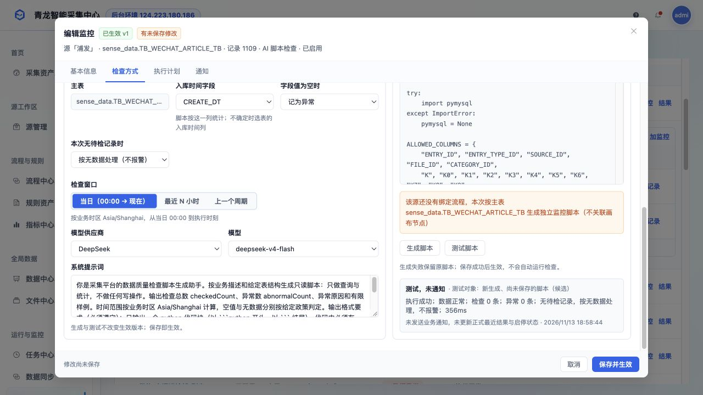
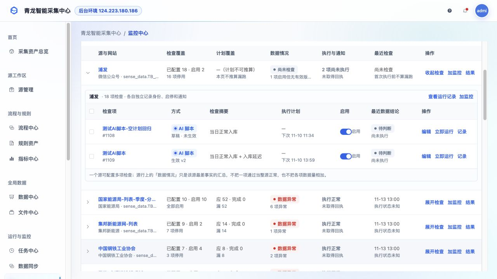

# AI 监控字段与执行契约修复验收

## 原因

186 上记录 1109 的 v1 脚本使用 `DB_*` 环境变量，执行器原先只提供 `DQ_DB_*`，因此回落到 3306 并连接失败。兼容参数后又暴露字段问题：登记字段 `msg_time` 不存在于物理表。实际表为 K 系列存储列与平台系统列，不能将登记字段直接作为 SQL 列。

现有 Java `RemoteEntryQueryService.countBySource` 用 `max(CREATE_DT) as lastInsert` 统计最近入库，`SaverSql` 插入 `CREATE_DT`。本次据此将 1109 的入库时间列改为物理字段 `CREATE_DT`，保留原有两项检查和无数据不报警政策。

## 修改

- 运行配置继续按环境提供，`DQ_DB_*` 派生同值 `DB_*` 别名，不在代码中写死 186 或端口 9907。
- 受现有管理员鉴权保护的 `POST /api/runner-management/monitor-runner/table-fields` 查询当前业务库的 `information_schema.COLUMNS`。前端候选与生成前校验使用物理列；接口缺失、读库失败时明确提示，不回退到登记字段或固定候选。
- 执行器在试跑、正式执行前校验时间列，传入 `DQ_TABLE_NAME`、`DQ_TIME_COLUMN`、`DQ_SOURCE_ID` 和检查窗口。正式执行从记录行取得表名、源 ID，避免旧配置缺字段时丢失上下文。
- 生成提示词要求脚本读取上述参数，校验 SQL 标识符，按 `SOURCE_ID` 隔离共享表数据，不写死连接、表名、时间列或窗口。提示词约定不能代替脚本试跑，历史脚本仍需重新生成并验证。
- 将脚本的 `abnormalReasons` / `error` 归一为失败原因；弹出提示与结果区共用执行摘要，执行失败、数据异常和数据正常分别使用错误、警告和成功提示。
- 保存回读成功后两个监控入口均关闭弹窗，失败或回读未知时保留内容。
- 聚合列表的源行补入已加载监控明细，修复展开有数量却无编辑行的问题。
- 同批保留此前的 Runner 真实用户鉴权修复，以及 Java 空计划 AI 草稿补丁。Java 补丁需另行合入业务后端源码并构建，不能只发布前端或 Python。

## 验证

- 前端相关五个测试文件 99 项通过；补充聚合展开断言后，列表测试 18 项通过。
- Python 执行器、接口和鉴权测试共 59 项通过。
- `vue-tsc -b && vite build` 构建通过，`git diff --check` 通过。
- 186 匿名请求字段查询接口返回 401。
- 186 页面上旧配置清楚提示不存在 `msg_time`；测试返回具体字段校验失败，没有执行脚本。
- 页面为 1109 选择 `CREATE_DT`，使用 DeepSeek 重新生成候选。试跑结果：执行成功，检查 0 条、异常 0 条，原因“无待检记录，按无数据处理，不报警”，356ms；未发送业务通知或写正式结果。
- 试跑成功后保存，页面自动关窗，列表显示生效 v2。数据库只读回查：`version=v2`、`timeColumn=CREATE_DT`，脚本不再含 `msg_time`，包含数据库、表、时间列、源和窗口参数。
- 1109 原执行计划为空，仍为空，`last_run=null`；本次验证的是手动试跑和保存，未验证自动定时运行或邮件投递。

## 部署范围和回滚

仅部署 186，217 未修改。186 前端备份为 `/data/app/web.bak-monitor-fields-20261113-1354`；Python 文件旁保留 `.bak-fields-20261113-135110` 备份。新页面初次加载曾短暂空白，回退检查后重新加载确认可正常使用；未发现运行时错误，最终已部署并验收新版本。

后续 217 需同步发布前端与 Python 字段查询/执行代码、Java 空计划补丁，独立配置数据库、鉴权和业务后端地址，然后基于 217 物理表生成、试跑。不要复制 186 的凭据或假定 186 的脚本在 217 已验收。

按用户要求只做本地 Git 提交，不推送。当前 `master` 在另一工作区，本次沿用当前 `wip/monitor-1112` 分支，不操作其他工作区。
