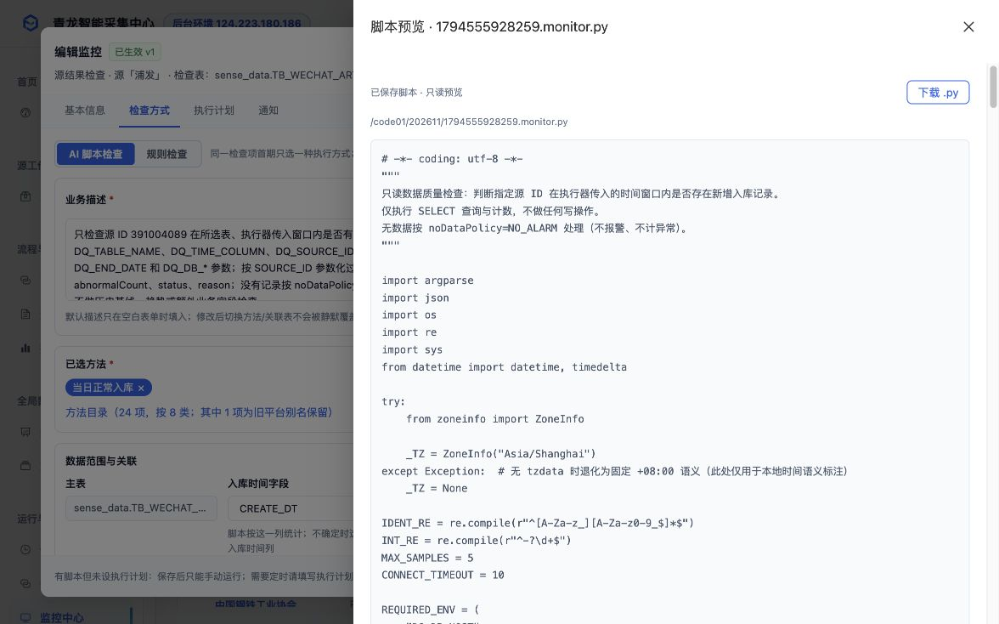

# AI 监控脚本文件展示、预览与下载

## 行为

- 生成中保留现有流式代码与思考展示；生成结束、文件上传并回读成功后，立即显示 Python 文件卡片，不要求先保存检查。
- 卡片展示文件名、文件服务路径、正文字符数，以及“待保存候选/已保存脚本”。同时保留原来的正文与复制功能。
- 点击预览打开右侧只读抽屉，显示完整脚本和下载按钮。只有路径的旧记录按需读取文件，读取失败显示具体错误。
- 下载导出当前所查看的脚本正文，使用对应 `.py` 文件名，UTF-8 编码；候选与已保存正文分开，预览/下载不触发保存、测试或正式执行。
- 无文件路径但有正文的历史记录提供 `.py` 导出文件名，并明确说明只有正文，不伪造服务端文件路径。

## 验证

- 编辑器与源监控页测试 2 文件、77 项通过，包含正文与路径同时展示、未保存候选预览、下载内容/文件名/Blob URL 释放、路径读取失败与恢复。
- `vue-tsc -b && vite build` 通过，`git diff --check` 通过。
- 186 admin 实际打开记录 1108：卡片显示 `1794555928259.monitor.py`、完整文件 ID、11718 字；右侧预览正常，下载入口可操作。
- 下载内容与文件名已通过组件测试验证。内置浏览器点击后没有回传下载完成事件，两次等待均超时，因此本次不将其记为真实浏览器下载落盘成功；没有为此修改标准 Blob 下载实现或绕过浏览器限制。
- 生成完成后无需保存即可展示候选，由组件生成流程测试验证；本轮没有额外生成或替换 1108 的有效脚本。

## 部署

已发布 186 前端，备份 `/data/app/web.bak-script-preview-20261113-161504`。217 未发布；本次不需要修改 Java 或 Runner。按既有约定只本地提交，不推送。

