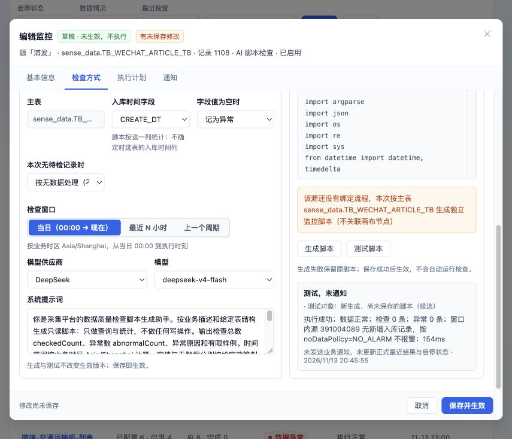
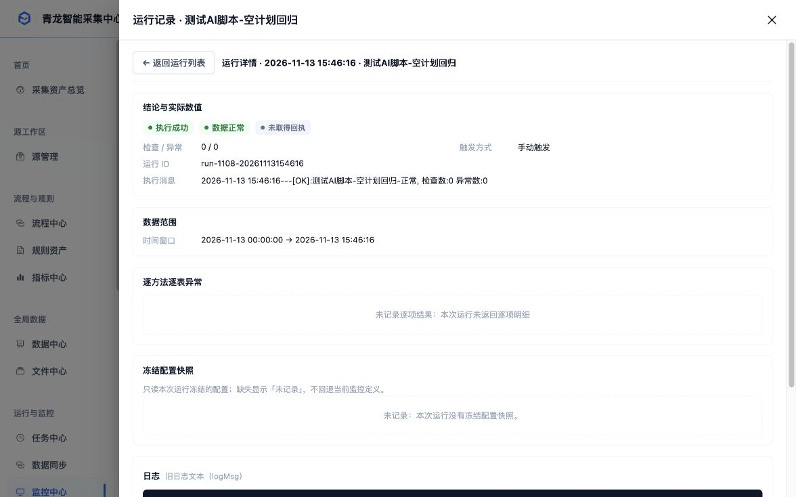

# AI 脚本文件与立即运行闭环实测

## 范围与结果

186，当前登录 admin。使用已有回归记录 1108（源浦发，391004089），没有修改用户的记录 1109。已在真实页面完成：重新生成 → 测试候选 → 保存 v1 → 立即运行 → 打开运行记录 → 查看详情。

- 被检表：`sense_data.TB_WECHAT_ARTICLE_TB`；时间字段 `CREATE_DT`；当日窗口；仅当前 SOURCE_ID。
- 候选试跑：执行成功，0 条待检记录、0 条异常，154ms，按已配置的无数据不报警政策处理。
- 正式执行：`run-1108-20261113154616`，2026-11-13 15:46:16（服务器业务时间）；日志 `LOG_ID=1982706`，执行成功，检查 0 条、异常 0 条，114ms。
- 页面记录列表与详情已读回这次正式运行。该无数据政策是本条回归检查配置，不代表“到期无新增告警”已验收。

## Python 文件确实存在

生成服务返回的脚本经前端清理并上传、下载回读，产物文件 ID 为：

`/code01/202611/1794555928259.monitor.py`

通过 186 的 `/api/file/download?fileId=...` 下载成功（HTTP 201），12664 字节，Python AST 解析成功。下载产物与 `ck_source.CHECK_CONF.script` 的 SHA-256 一致：

`b08b148a7b5e518bbe1fe639622b4873e15f79cf646485b2a1ac6bfea4fca430`

本地留档：`1113-AI脚本闭环实测/monitor-1108-v1.py`。

此路径是文件服务中的文件 ID，不是 186 操作系统上的同名绝对路径。页面有脚本正文时使用 `v-else-if` 隐藏路径，导致用户看不到文件位置。Runner 实际读取保存的脚本正文，临时写成 `*.monitor.py` 子进程执行，结束后删除临时文件；文件服务的生成产物仍存在。两者需要区分，不能因临时文件已删除就认为没有生成文件。

## 本次发现并修复的结果回读问题

原 `SourceCheckController.pagedLogs` 对所有非 null 的 groupId 加日志过滤。但 `AuthCenter.getGroupId()` 明确把 admin 映射为 0，表示全部；监控配置列表也已对 0 跳过分组条件。因而 admin 能看到配置和执行成功，却因 `group_id=0` 查不到本次 `GROUP_ID=null` 的日志。

只调整日志查询：非 null 且非 0 时加分组过滤，与配置列表口径一致。普通账号继续按所属分组查询，sourceId/jobId 条件保留，不修改日志归属，不取消普通账号隔离。

- 补丁：`backend/java_patches/admin_monitor_logs_scope.patch`。
- 契约程序：`backend/java_patches/MonitorLogScopeContract.java`。
- 验证 admin 全局、普通账号 group 9 过滤、源/检查身份条件保留；原实现运行该程序会失败，修复实现通过。
- 使用当前运行 jar 的依赖编译；编译基线字节码与部署中的控制器核对一致，仅替换目标控制器 class。
- 186 备份：`/data/app/backend/bee-config.jar.bak-log-scope-20261113-160339`；重启恢复，真实 admin 页面刷新后看到记录与详情。
- 217 未修改；后续 Java 发布需合入该补丁。

## 仍存在的限制

本次日志 JOB_CONF 仅保留 1000 字符，JSON 已截断，详情正确显示“没有冻结配置快照”。因此本次证明最小链路的生成、试跑、正式运行与数值回读，不宣称完整历史版本快照、异常/失败分支、定时调度和通知投递已验收。快照修复应避免把长脚本直接塞入受限文本列，需按产物引用与范围摘要契约另行收口。

本轮未修改其他会话正在进行的前端、执行器或异常事件改动；未推送。

