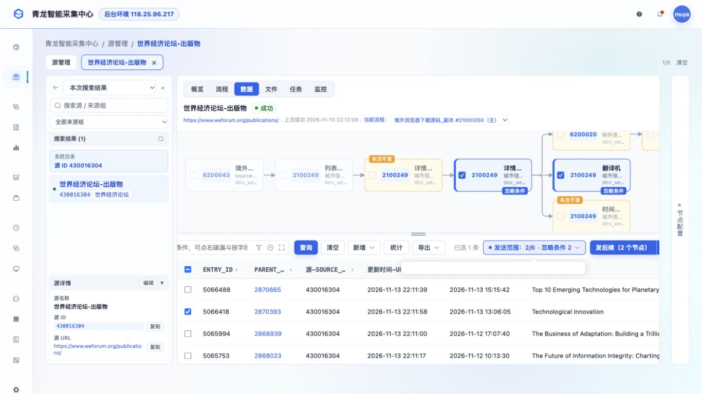
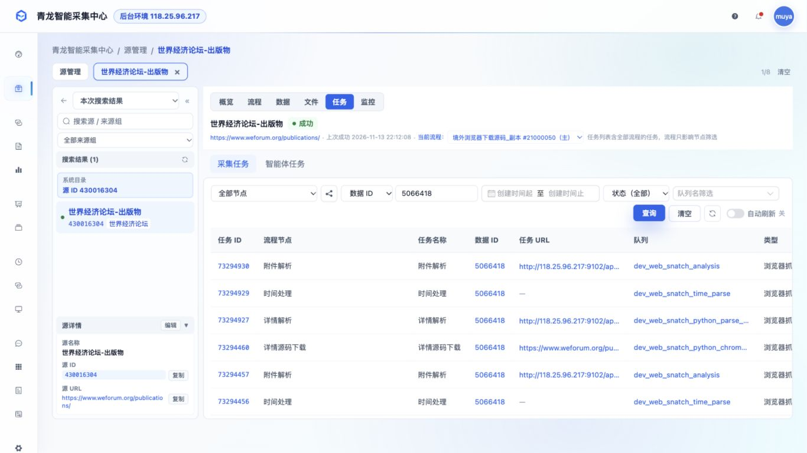

# 节点多选与批量忽略条件：217 发布与实测

日期：2026-11-14。用户授权完成后部署 217，并使用已登录的 2806 自测。

## 实现

- 功能提交：`ca375481`，基于已同步两个远程的 `90d205da`，汇总到本地 master。
- 流程图新增“多选发送节点”，复用现有轨道多选能力。选择发送目标不会切换当前数据节点，也不会清空已勾选数据行。
- 发送范围面板支持逐节点及批量忽略进入条件；搜索时批量操作仅作用于匹配且已选发送、有进入条件的节点。
- 多选、排除和忽略条件实时同步到节点样式及角标。排除节点会清除其条件覆盖；发送成功恢复默认，失败保留设置以便重试。
- 沿用旧接口 `itemConfig` 和 `skipCond=1`。部分节点忽略时仍拆分发送，不改变节点保存的条件，不绕过原有幂等检查。
- 部署脚本补上遗漏的 `cfg.oss = target.oss`，确保候选构建及切换使用正确的 217 OSS 地址。

## 验证

- 6 个相关测试文件、358 项测试全部通过；涵盖多节点覆盖、混合普通发送、取消后的清理、失败重试及真实 HTTP 参数契约。
- Vue/TypeScript 检查、正式构建及变更文件 ESLint 通过。
- 2806 实际页面按 1366 × 768 验证：“详情解析”和“翻译机”同时选中并显示两个“忽略条件”角标，记录 `5066418` 的勾选保持不变。
- 清空到零节点时发送禁用；重新勾选不会继承被清除的条件覆盖。
- 源 `430016304`、记录 `5066418` 实际仅向“详情解析”发送一次忽略条件任务，创建任务 `73294927`，执行结果 `IsSuccess=true`，状态“完成”。此前该记录已有 K5，而节点条件为 `K5 == nil`。
- 自动后续“时间处理”任务 `73294929` 完成；“附件解析”任务 `73294930` 异常、错误消息为空。该记录此前的附件解析任务 `73294457` 同样异常，本次未修改执行脚本。
- 验收结束恢复默认发送范围、清除条件角标及测试视口覆盖。

## 发布与回滚

- 先构建独立 8086 候选并自检，再用原部署脚本 release 切换到 806 / 公网 2806。
- 网关镜像：`sha256:0fd77a0c8ae7c247d075dc9692ecd7cb075b83509476d974d1e9e823b3c66ee2`，状态 healthy。
- 回滚标签：`sjcj-gateway:backup-20261114-before-node-send`，对应上线前镜像 `sha256:393b2da8dbbc8d724a63cb39afca5995963eeab30b3fe20a8a378bfccfa5034a`。
- 前端业务后端 `118.25.96.217:9999`，OSS `118.25.96.217:9102`。133 容器镜像及启动时间与发布前一致。
- 首页及入口、ResultView、ProcessNodeRail 的 JS/CSS 共 7 个公网文件全部 200，SHA256 与容器文件一致。
- 本地日志：`tmp/1114-node-send-217-candidate.log`、`tmp/1114-node-send-217-release.log`、`tmp/1114-node-send-217-public-check.json`。

## 截图

